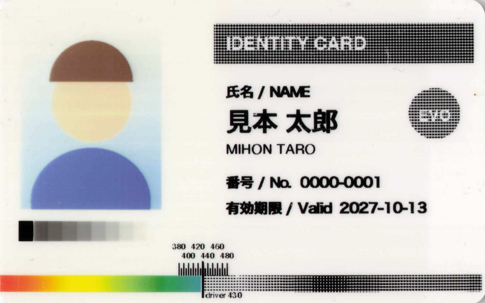
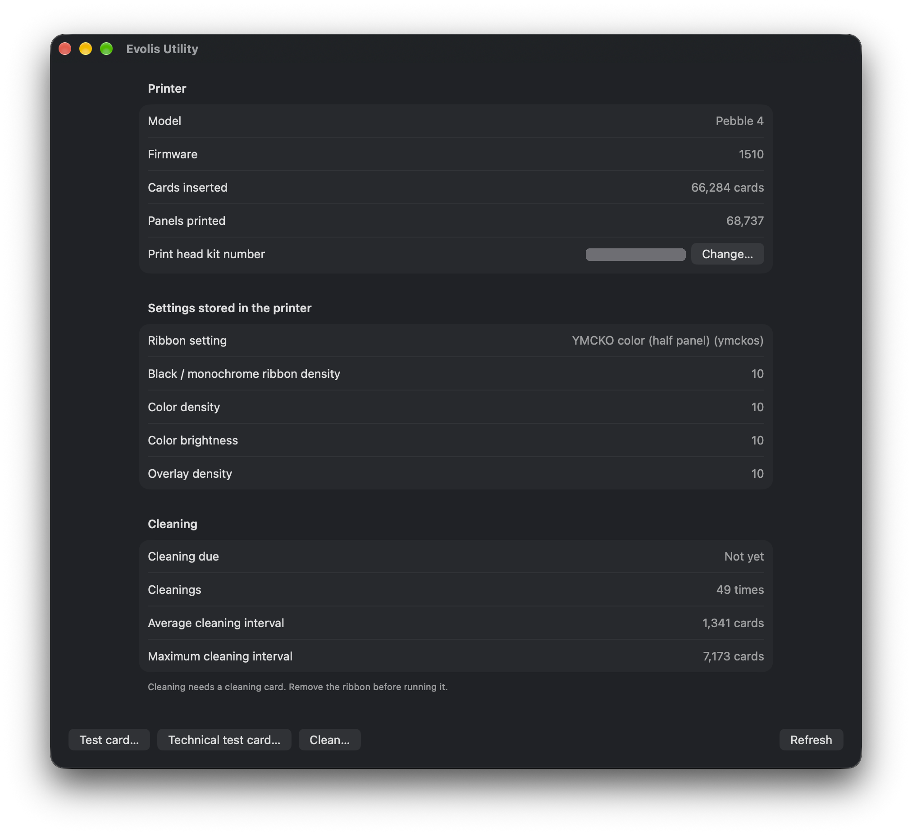

# Evolis Pebble 4 driver for macOS

[日本語版 README](README.md)

A CUPS driver that lets you print from the macOS print dialog to the **Evolis Pebble 4** ID card printer.
Evolis ships no current macOS driver for the Pebble generation (there is no Pebble row in their
[driver compatibility chart](https://www.evolis.com/wp-content/uploads/2022/05/Drivers-Compatibility-Chart-ENG.pdf)),
but the printer's command language is documented and it is a plain USB printer-class device.

**You can print from the macOS print dialog (confirmed on 2026-10-13 with macOS 27.0.1 on Apple Silicon).**
Tested on real hardware with a black (K) ribbon and a half-panel YMCKO color ribbon (R3013). Other ribbons
(full-panel YMCKO, KO, and the single-color ribbons such as white and gold) are supported by the driver but have
not been tested on a printer. The Pebble 4 prints on one side only.

> **This is an unofficial driver.** It is not affiliated with, endorsed by, or supported by Evolis.
> Use it at your own risk ([see below](#no-warranty)).



*Scan of the sample card ([samples/sample-card.pdf](samples/sample-card.pdf)) printed from the v1.1 print dialog with a
half-panel YMCKO ribbon (R3013). The left part (about 36 mm) is in color; the right part is printed as a halftone on the black panel.*

> **Languages:** the print-dialog options, the Evolis Utility app, the command-line tools and the queue messages are in
> **English and Japanese** and follow the macOS language setting (from v1.2; v1.1 and earlier are Japanese only).

## Installation

Download `evolis-pebble4-<version>.pkg` from
[Releases](https://github.com/yukino1230/Evolis-Pebble-4-macOS-Driver/releases/latest) and double-click it
(it is signed with a Developer ID and notarized by Apple). Then connect the printer over USB, turn it on, and create the queue:

```bash
sudo evolis-setup --ribbon k
```

Pass the ribbon that is loaded with `--ribbon` (`k` black / `ymckos` half-panel color / `ymcko` full-panel color, etc.;
see [Ribbon types](#ribbon-types-pr)). When you change the ribbon, run
`sudo lpadmin -p Evolis_Pebble_4 -o EvolisRibbon=<type>`.

| Installed | Location |
|---|---|
| CUPS filter (Intel and Apple Silicon) | `/usr/local/libexec/cups/filter/rastertoevolis` |
| PPD | `/Library/Printers/PPDs/Contents/Resources/EvolisPebble4.ppd.gz`, `/usr/local/share/evolis/Pebble4.ppd` |
| Queue setup command | `/usr/local/bin/evolis-setup` |
| Printer function command | `/usr/local/bin/evolis-tool` (test card, technical test card, cleaning) |
| Utility app | `/Applications/Evolis Utility.app` (printer status, cleaning due, test cards, cleaning) |

**You can also add the printer without the Terminal.** The PPD carries the printer's device ID (`MFG:EVOLIS;MDL:Pebble`), so in
System Settings → Printers & Scanners → Add Printer, choosing "EVOLIS Pebble" (kind: USB) selects the
"Evolis Pebble 4" driver automatically (confirmed). The queue is then named `EVOLIS_Pebble`. Two things differ from `evolis-setup`:

- If the USB backend fails (for example, the printer is switched off in the middle of a job), the whole queue is paused until
  you press Resume in the queue window (CUPS default `printer-error-policy=stop-printer`). To cancel just that job instead,
  run `sudo lpadmin -p EVOLIS_Pebble -o printer-error-policy=abort-job`. Jobs stopped by the driver (filter) itself, such as a
  wrong paper size, only stop that job regardless of this setting.
- The default ribbon is black (`k`). For a color ribbon run `sudo lpadmin -p EVOLIS_Pebble -o EvolisRibbon=ymckos` or pick it in the print dialog.

Uninstall:

```bash
sudo evolis-setup --remove           # if you added the printer in System Settings, delete it there instead
sudo rm -f /usr/local/libexec/cups/filter/rastertoevolis /usr/local/bin/evolis-setup /usr/local/bin/evolis-tool \
           /Library/Printers/PPDs/Contents/Resources/EvolisPebble4.ppd.gz
sudo rm -rf /usr/local/share/evolis "/Applications/Evolis Utility.app"
sudo pkgutil --forget jp.yukino.evolis-pebble4
```

### Print dialog options

The options appear under "Printer Options" in the print dialog.

| Option | Values |
|---|---|
| Media Size | CR80 card (85.6 × 54 mm), borderless |
| Ribbon | Must match the loaded ribbon ([Ribbon types](#ribbon-types-pr)) |
| Overlay (protective layer) | Full card / None / Avoid IC chip (ISO 7816) / Avoid magnetic stripe (ISO 7811, back side) |
| Black panel rendering | Gray (halftone, default) / Line art (black or white) |
| Black / monochrome ribbon density | 0–20 (standard 10) |
| Color density (color ribbons) | 0–20 (standard 10) |
| Color brightness (color ribbons, higher = lighter) | 0–20 (standard 10) |
| Overlay density | 0–20 (standard 10) |

### Evolis Utility

An app to see the printer's status and call its built-in functions. The pkg installs it in `/Applications`; start it from the
Applications folder, Launchpad or Spotlight. The PPD also sets `*APPrinterUtilityPath`, but current macOS (27) has no
"Open Printer Utility" button in Printers & Scanners ("Options & Supplies" only has General and Supply Levels), so it cannot be opened from there.



- **Printer**: model, firmware, number of cards inserted, number of panels printed, print head kit number (`Rkn`)
- **Settings stored in the printer**: ribbon type, black / color / overlay density, color brightness
- **Cleaning**: whether cleaning is due (`Rlr;r`), number of cleanings, average and maximum interval
- **Buttons**: test card, technical test card, cleaning (each asks for confirmation)
- **Changing the print head kit number**: after replacing the print head, write the kit number from the white label of the new head
  to the printer (`Pkn;<number>`, step 3 of "Replacing the print head" in the user guide; on Windows it is sent from the official
  driver's printer dialog). A wrong number makes the printer print incorrectly, so the app asks for it twice, sends it only when both
  match, and reads it back with `Rkn`. Clean the printer before printing again. The kit number contains the head's serial number,
  so hide it in screenshots you share

It talks to the printer over USB directly with macOS's IOUSBHost (no libusb or Python needed). While a job is printing, CUPS
holds the printer and the app shows it as busy. Source in [`app/`](app/), built with `app/build-app.sh`.

### Building from source

Requires the Xcode command line tools (`xcode-select --install`) and python3.

```bash
./driver/build-pkg.sh 1.2              # produces build/pkg/evolis-pebble4-1.2.pkg
sudo driver/install.sh --ribbon k      # build and install in place without a pkg (for development)
```

`build-pkg.sh` signs automatically when a Developer ID certificate is available (otherwise the pkg is unsigned).
Set `EVOLIS_NOTARY=<notarytool profile name>` to notarize as well.

After changing the filter, run `tests/run.sh` to check that what gets printed has not changed (it compares the bytes sent to the
printer for 7 test rasters and 22 option combinations). When you change the output on purpose, record it again with `tests/run.sh --update`.

## Background (research as of 2026-10-13)

| | |
|---|---|
| Command reference | The official **Evolis Card Printers Programming Guide A5013** covers New Pebble / Tattoo / Dualys / Quantum / Kiosk. **"A5013" in this repository means Rev.E** (a local PDF, not published because it is copyrighted). Copies can be found online: [Rev.D2](https://www.yumpu.com/en/document/view/54519120/new-pebble-programming-guide-a5013-revd2/9) (cover titled "NEW PEBBLE PROGRAMMING GUIDE") and a [Qu2 edition](https://idoc.pub/documents/programming-guide-evolis-qu2-en5k9g7wqpno) |
| Official Linux driver | RPM / DEB packages for the generation including **Pebble 2 / 3 / 4** were released in December 2014 (now legacy) |
| Official macOS driver | The [current compatibility chart](https://www.evolis.com/wp-content/uploads/2022/05/Drivers-Compatibility-Chart-ENG.pdf) has **no Pebble row** |
| Open-source example | [dpavlin/Printer-EVOLIS](https://github.com/dpavlin/Printer-EVOLIS) (for the Dualys 3, Perl, GPLv2+) shows the actual bytes sent |
| Connection | **USB printer class** (Windows sees it as `USBPRINT\EVOLISPEBBLE…`). Raw bytes can be sent from macOS without a kernel extension |

### Command format

`ESC` + ASCII + `CR`. From [`evolis-driver.pl`](https://github.com/dpavlin/Printer-EVOLIS/blob/master/scripts/evolis-driver.pl):

```
ESC Pr;k      CR   ribbon: black
ESC Pmi;F;s   CR   insertion mode
ESC Pc;k;=;10 CR   contrast
ESC Ss        CR   start sequence
ESC Sr        CR   front side
ESC Db;k;2;<bitmap> CR   send bitmap (1-bit packed)
ESC Sv        CR   back side
ESC Se        CR   end sequence
+ 64 bytes of 0x00 padding
```

Queries (from [`evolis-command.pl`](https://github.com/dpavlin/Printer-EVOLIS/blob/master/scripts/evolis-command.pl)). **These use no card and no ribbon**:

| Command | Returns |
|---|---|
| `ESC Rtp CR` | printer model |
| `ESC Rfv CR` | firmware version |
| `ESC Rsn CR` | serial number |
| `ESC Rco;p CR` | number of panels printed (counter) |

## Verified on the printer (2026-10-13)

| | |
|---|---|
| USB | VID `0x0F49` / PID `0x0100`, bcdDevice `0x0602`. Interface 0 is printer class (class 7 / protocol 2 = bidirectional, bulk OUT/IN). CUPS URI `usb://EVOLIS/Pebble?location=20100000` |
| Another USB port | Re-plugging changes the URI's `location` (`20100000` → `20200000`), but the queue with the old URI still printed (macOS CUPS finds the device by make and model). The USB serial number is empty |
| Access | macOS does not claim class 7, so libusb (pyusb) can claim the interface directly |
| Replies | ASCII terminated by `\0`. **The same reply is returned on every IN read until the next command is sent**, so cut at the first `\0` |

Results from [`tools/evolis_query.py`](tools/evolis_query.py):

| Command | Reply |
|---|---|
| `Rtp` | `Pebble 4` — the A5013 command set works as is |
| `Rfv` | `1012` |
| `Rsn` | `PB0839xxxxxxx` |
| `Rco;l` | `2` (`l` is not in A5013; meaning unknown. No reply when read on another day) |
| `Rco;p` / `Rco;c` | `68675` / `66262` (panels printed / cards inserted) |
| `Rco;a` / `Rco;m` / `Rco;n` | `1341` / `7173` / `49` (average / maximum cards between cleanings / number of cleanings) |
| `Rx` / `Ry` | `17` / `15` (horizontal / vertical print offset; set with `Px` / `Py`) |
| `Rmi` | `Feeder` (cards are fed from the feeder; set with `Pmi`) |
| `Rkn` | `411-D85xxxxx-D` (print head kit number; the first 3 digits are the head resistance × 10) |
| `Rse` | `ERROR CDE` — the reply to an unknown command |

```bash
python3 -m venv .venv && .venv/bin/pip install pyusb
.venv/bin/python tools/evolis_query.py            # Rtp Rfv Rsn Rco;p
.venv/bin/python tools/evolis_query.py "Rr;p" "Rc;k"
```

### Single-sided black printing (succeeded 2026-10-13)

The minimal sequence sent by [`tools/evolis_print.py`](tools/evolis_print.py). `Pmi` (insertion mode) and `Pc` (contrast) are not sent; the printer's defaults work.

```
ESC Pr;k CR
ESC Ss CR
ESC Sr CR
ESC Db;k;2;<82296 bytes> CR
ESC Se CR
0x00 x 64
```

- The image covers the whole card: **1016 × 648 dots (300 dpi, landscape)**
- It is sent rotated 90° clockwise: 1016 lines of 648 dots = 81 bytes each, MSB first, **1 = black**
- In this orientation the card comes out as it looks on screen (no flips)

```bash
.venv/bin/pip install pillow
cd tools
../.venv/bin/python make_testcard.py /tmp/testcard.png
../.venv/bin/python evolis_print.py /tmp/testcard.png --send
```

### Color (YMCKO) printing (succeeded from the tool on 2026-10-13)

Printed following A5013 (Rev.E) and
[the qz-tray implementation](https://github.com/qzind/tray/blob/master/src/qz/printer/action/raw/converter/Evolis.java).

```
ESC Pr;ymckos CR                    ribbon (ymckos for the R3013 half panel, ymcko for full panel)
ESC Ss CR
ESC Sr CR
ESC Db;y;32;<411480 bytes> CR      Y/M/C: 5 bits per dot packed bit by bit (MSB first). Value = amount of ink, 0 = none
ESC Db;m;32;<411480 bytes> CR
ESC Db;c;32;<411480 bytes> CR
ESC Db;k;2;<82296 bytes> CR        black (resin) is 1 bit
ESC Db;o;2;<82296 bytes> CR        overlay, 1 = apply the protective layer
ESC Se CR
```

- Dot order is the same as for black (card rotated 90° clockwise, 1016 lines of 648 dots)
- **The ribbon type set with `Pr` is stored in the printer** and can be read with `Rr;p`. The old official driver also sent
  `Pr;<ribbon>;t`; firmware 1012 answered `ERROR PARAMETRES`. Firmware 1510 accepts it, but the setting survives a power cycle
  (it is not a temporary setting), so the driver does not add `t`
- **A wrong ribbon type can jam the card or break the ribbon.** Sending `ymcko` with the half-panel R3013 loaded stopped in
  the middle of printing; the overlay ribbon stuck to the card and broke when it was peeled off
- **With the half-panel ribbon (R3013), color is printed only on the left of the card**: about 43% from the left edge (about
  435 dots). Black and overlay cover the whole card. A5013 has a partial download for half-panel ribbons, `Dbp` (up to 420 lines),
  and a start position `Psp` / `Rsp`, but the driver sends full `Db` panels and limits color to 430 dots (the sample card shows
  color up to 430 without gaps)
- A5013 lists `Db` data sizes of 84,624 / 423,120 bytes, but the formula on the same page (648 × 1016 × bits ÷ 8) gives
  82,296 / 411,480 bytes, which is what works
- Only near-black neutral pixels (each RGB value below 24, spread below 24) go to the black panel; everything else is printed with Y/M/C
- **The driver sends Y/M/C at 128 levels (`Db;y;128`, 7 bits per dot, 576,072 bytes per panel).** The example above is the
  32-level version tried first. Printing C / M / Y / gray ramps at 32 and 128 levels and comparing them, 128 levels showed
  smaller steps (standard deviation of brightness along the band: gray 1.45 → 1.05, magenta 0.94 → 0.71; yellow and cyan about
  the same). The old official macOS filter also has code to send 128 levels. Add `EvolisColorLevels=32` to a job to go back to 32 levels

  | 32 levels | 128 levels |
  |---|---|
  |  |  |
- **Error diffusion on the black panel collapses to solid black at around 60%** (resin black spreads around each dot).
  The driver uses a 6 × 6 clustered dot (50 lpi) with a correction measured from a
  [calibration card](tools/make_halftone_cal.py). Measured on the black panel of an R3013 ribbon (requested % → apparent %):

  | Requested | 10 | 20 | 30 | 40 | 50 | 60 | 70 | 80 | 90 |
  |---|---|---|---|---|---|---|---|---|---|
  | Error diffusion (no correction) | 8 | 14 | 40 | 74 | 53 | 101 | 106 | 106 | 106 |
  | 6×6 cluster, requested^1.6 | 0 | 10 | 17 | 30 | 47 | 63 | 76 | 92 | 103 |

  | Error diffusion (first version) | 6×6 clustered dot |
  |---|---|
  |  |  |

  

  *Calibration card with 0–100% steps for several dot patterns and corrections. Rows A–C use error diffusion, D–F a 4 × 4
  cluster, G and H a 6 × 6 cluster. Row G gets darker most evenly.*
- **A single-color black ribbon spreads less than the black panel of a color ribbon.** With the color-ribbon correction, dark
  grays (56–89%) came out 10–15 points too light. 6 × 6 cluster steps were printed without correction at 5% intervals on a black
  ribbon (`make_halftone_cal.py --set linear --ribbon k`, four times each) and measured from a grayscale scan:

  | Dot coverage | 10 | 20 | 30 | 40 | 50 | 60 | 70 | 80 | 90 |
  |---|---|---|---|---|---|---|---|---|---|
  | Black ribbon (apparent %) | 11 | 24 | 36 | 46 | 60 | 75 | 81 | 91 | 96 |

  The 10-step gray wedge on the sample card after the correction (black ribbon, density 10):

  | Requested | 100 | 89 | 78 | 67 | 56 | 44 | 33 | 22 | 11 | 0 |
  |---|---|---|---|---|---|---|---|---|---|---|
  | Before (color-ribbon table) | 100 | 74 | 63 | 52 | 43 | 36 | 29 | 22 | 10 | 0 |
  | After (black-ribbon table) | 99 | 86 | 77 | 61 | 52 | 43 | 32 | 22 | 11 | 1 |

  The driver uses one table for the black panel of color ribbons and another for single-color ribbons (black, white, gold, …
  and KO). Single-color ribbons other than black, and KO, are assumed to behave like black.
  **Always scan in grayscale (or color).** A black-and-white (1-bit) scan makes the dots look fatter, e.g. 10% measures as 21% and 50% as 71%
- On the black panel, colors are rendered as gray by brightness and printed as a halftone (pure black is solid). A version that
  switched to solid black above 60% was tried and dropped, because gradients jumped to solid black part-way
- **When designing cards for a half-panel ribbon, keep color within the left part (about 36 mm) and use only black and white on
  the right.** Color on the right becomes a gray halftone (a dark blue bar, for example, becomes a 72% halftone). If something
  should print solid black, make it black in the design rather than relying on the driver

```bash
cd tools
../.venv/bin/python make_colorcard.py /tmp/colorcard.png
../.venv/bin/python evolis_print.py /tmp/colorcard.png --ribbon ymckos --send
```

### Ribbon types (`Pr`)

This Pebble 4 accepted every code listed in A5013 in lower case (set with `Pr`, read back with `Rr;p`). Upper-case codes such
as `Ktc` return `ERROR PARAMETRES`.

Part numbers and prints per roll are taken from the [supplies list](https://www.cardex.jp/supply/list/) of Cardex (cardex.jp),
for the Pebble PBL-4, as of 2026-10-13.

| `Pr` value | `Rr;p` reply | Part number (prints per roll) | Panels sent | Driver | Tested |
|---|---|---|---|---|---|
| `k` (`kb` is the same) | k Black | R2011 black (1,000) | K | ✅ | ✅ |
| `kbl` | k Blue | R2012 blue (1,000) | K | ✅ | not yet |
| `kr` | k Red | R2013 red (1,000) | K | ✅ | not yet |
| `kgr` | k Green | R2014 green (1,000) | K | ✅ | not yet |
| `kw` | k White | R2015 white (1,000), R2030 white signature panel (1,000; `kw` is a guess) | K | ✅ | not yet |
| `kgo` | k Gold | R2016 gold (1,000) | K | ✅ | not yet |
| `ksi` | k Silver | R2017 silver (1,000) | K | ✅ | not yet |
| `ksc` | k Scratch | R2018 scratch-off (1,000) | K | ✅ | not yet |
| `ka` | k Wax Plastic | not in the list (none found for the Pebble; see below) | K | ✅ | not yet |
| `ymcko` | ymcko | R3011 (200) | Y M C K O | ✅ | not yet |
| `ymckos` | ymckos | R3013 half panel (400) | Y M C K O (Y/M/C only on the left) | ✅ | ✅ |
| `ko` | ko | R3012 black + overcoat (500) | K O | ✅ | not yet |
| `ymckok` | ymckok | R3314 (200). **Not for Pebble** (the [datasheet](https://fr.evolis.com/wp-content/uploads/2024/01/datasheet-ymckok-eng.pdf) lists SECURION / QUANTUM2) | — | not supported | |
| `h` `ho` | h | R4002 hologram (350). **Not for Pebble** (the [datasheet](https://fr.evolis.com/wp-content/uploads/2026/03/datasheet-generic-holo-varnish-eng.pdf) lists QUANTUM2 / SECURION) | — | not supported | |
| `ktc` `ktp` | k Direct Thermal Card / Paper | no ribbon | — | not supported (prints directly on special cards) | |

R3314 and R4002 appear under PBL-4 in the Cardex list, but as shown above the Evolis datasheets do not list the Pebble.

The Cardex PBL-4 list has two more ribbons, checked against the Evolis datasheets:

- **R2030 White Signature** ([datasheet](https://fr.evolis.com/wp-content/uploads/2023/12/datasheet-white-signature-eng.pdf)):
  a single-color ribbon that prints a white panel you can sign with a pen. PEBBLE / DUALYS are listed. The `Pr` value is not
  given; printing it as a white single-color ribbon with `kw` seems reasonable (the white panel goes where the design is black)
- **R2029 BlackFLEX** ([datasheet](https://www.evolis.com/wp-content/uploads/2023/04/datasheet-blackflex-eng.pdf)):
  a black single-color ribbon for ABS, PET, PC, rough PVC and paper cards. **The datasheet lists only SECURION and QUANTUM2,
  not the Pebble** (unlike the Cardex list). Its use is close to `ka` (black wax for ABS and similar cards), but the `Pr` value is unknown

For black wax (`ka`, `k Wax Plastic`), the ribbon found is **R2139 BlackWAX** (3,000 prints), but resellers list it for the
Quantum 2 (some also for the original Quantum), not the Pebble, and Pebble ribbons are 1,000-print rolls. Some resellers mark it
discontinued with no replacement while others still list it, so it is unclear whether it can still be bought (as of 2026-10).
No black wax ribbon for the Pebble was found, so `ka` is accepted only because A5013 lists it and is probably never needed.

Both datasheets say single-color ribbons are continuous ribbons with a "ribbon saver" feature that uses only the printed area
plus 7 mm (a printer-side feature).

Every single-color ribbon is one K panel, and **the ribbon's color goes where the image is dark** (with a white ribbon,
what you draw in black prints white). Untested ribbons are sent as A5013 describes them.

**The printer cannot tell which ribbon is loaded.** This Pebble generation has no ribbon RFID chip; `Rr` / `Rr;p` only return
the value set with `Pr`, and A5013 describes no automatic detection. Other ribbon-related reads gave no clue either
(2026-10-13, with an R3013 loaded):

| Command | Reply | Meaning (A5013) |
|---|---|---|
| `Rr` | `ymckos` | ribbon type stored in the printer's memory |
| `Rcr` | `OK` | not on the black end mark (for color ribbons) |
| `Rrs` | `S D` | ribbon size handling (`S` = 200-card ribbon, `L` = 1000-card; for the take-up voltage) |
| `Rro` | `552 588 38` | ribbon offset |
| `Rsp` | `0 0` | start position for half-panel ribbons |
| `Rco;l` | `2` | `l` is not in A5013 (the remaining-prints estimate is `Rco;I`: `ERROR PARAMETRES` on firmware 1012, `1000` on 1510) |
| `Rrm` | no reply | |

**When you change the ribbon, set the driver's ribbon to match.** A mismatch can jam the card or break the ribbon (with the
half-panel R3013 and `ymcko`, the overlay ribbon stuck to the card and broke when peeled off). Ways to switch:

- **Print dialog presets** (recommended): choose the ribbon, then Presets → Save Current Settings as Preset, e.g. "Color (half
  panel)" and "White". Selecting a preset then switches the ribbon
- **Change the queue default** (no reinstall needed):

  ```bash
  sudo lpadmin -p Evolis_Pebble_4 -o EvolisRibbon=ymckos
  ```

### Paper size in the print dialog

**When printing a PDF from Preview, the print dialog opens with the paper size "Other (210 x 297 mm)". Choose "CR80 card" every time.**

**In Pages and Word, choose printer "Evolis Pebble 4" and paper "CR80 card" in the document's Page Setup**
(neither print dialog has a paper size field; the document's page setup is used. Confirmed for both).

- The initial paper size comes from the app's page setup (in Preview, the system-wide default paper, A4). The printer has no
  A4, so it shows "Other"
- CR80 is not a standard CUPS media name; CUPS reports it to macOS as `custom_54x85.6mm_54x85.6mm`. No way was found to have it
  treated as a standard size (Brother label printers have the same issue and solve it with their own print dialog extension)
- Defining the paper in portrait (54 × 85.6 mm) did not change this
- Saving the paper size in a preset does not help: Preview goes back to "Default Settings" the next time
- Advertising "the loaded media is CR80" (`media-default` / `media-ready`) as an AirPrint (IPP Everywhere) printer still opened
  Preview with "Other (210 x 297 mm)" (tested with a test printer set up with `ippeveprinter`). As there seems to be no way
  for the printer side to set the initial paper, no print dialog extension (PDE) like Brother's was written
- Pages and Word print with the paper from the document's page setup

**Forgetting to choose the paper and printing with "Other" used to eject a blank card.** The app renders an A4 page (with the
card artwork in the middle) and macOS replaces only the media with CR80 (the job's `media` is `CR80`). The raster gets the
bottom-left card-sized part of the A4 page, which is blank.

So the driver **does not print blank pages**. If the whole job is blank, it stops without sending a card and shows
"Nothing to print. Set the paper size to "CR80 card" in the print dialog" in the queue. Jobs stopped by the driver (filter) are just marked "Stopped" by CUPS; the
printer itself keeps going (the next job prints normally). The queue's `printer-error-policy` applies only to USB backend
failures, not to filter failures (`finalize_job` in [CUPS `scheduler/job.c`](https://github.com/apple/cups/blob/master/scheduler/job.c)).
The stopped job stays in the queue with the message; delete it with "×" (Resume stops it again for the same reason).
(A raster larger than a card is also refused, as a safeguard for `lp` with a large paper size.)

### When there are no cards

**If the feeder has no cards (or is removed), the job stays "Printing".** The printer does not accept data until a card
arrives, and it has no way to report the missing card to the Mac (no reason appears in the queue). `Rlr;p` still read `OK` with no cards.

- **To print it**: load cards and it prints
- **To cancel it**: cancelling in the queue does not stop it (the CUPS USB backend stays blocked mid-write and part of the
  data is already in the printer). **Cancel the job, then switch the printer off and on before loading cards.** Otherwise
  the leftover data prints one card

The insertion mode is a printer setting (read with `Rmi`; this unit says `Feeder`); the driver does not send `Pmi`.
`Pmi;F` (feeder) and `Pmi;M` (manual) are accepted and change `Rmi` to `Feeder` / `Manual`. `Pmi;B` (feeder if no card inside)
returns `ERROR PARAMETRES`.

**Printing with `Pmi;M` (manual) while the feeder is attached sent the card back toward the feeder, jammed it and raised an
error.** Switching back to `Pmi;F` without a power cycle still did not print correctly (cards came back, etc.).
**A power cycle restored it.** A "Paper feed (feeder / manual)" option was tried in the print dialog and removed: the manual
feed cartridge (an option) was not available to test, choosing manual with the feeder attached does real damage, and the
"Automatic" choice macOS adds behaves the same as "printer setting". **Behavior with the manual feed cartridge is untested**
(including what happens without cards).

### Overlay area

You can choose where the protective layer (O panel) is not applied. The areas follow the card standards (measured from the
top-left of the card front):

| Choice | Area without overlay | Basis |
|---|---|---|
| None | whole card | cards that will be written on, or laminated separately |
| Avoid IC chip | x 8.5–21.5 mm, y 17.5–30.5 mm | ISO 7816-2 contacts (x 10.25–19.87, y 19.23–28.55) plus the module size |
| Avoid magnetic stripe | y 5.0–17.6 mm, full width | ISO 7811 stripe (y 5.54–15.82) with a margin; matches the area in the [qz-tray](https://github.com/qzind/tray/issues/269) example |

The old official driver also had "Avoid IC chip (AFNOR)", which is not included because its dimensions are unknown.
Printing the sample card with "Avoid IC chip" left a rectangle without overlay at the intended position (visible against the
light; colors look shallower without the overlay). "Avoid magnetic stripe" likewise left a band without overlay: the
reflection changes at 5 mm and 17.6 mm from the top edge (tested on the front). With "None", the printing sound changed at
the overlay panel (no overlay applied); PVC cards are glossy anyway, so it is hard to see.


*A card printed with "Avoid IC chip", photographed against the light. The rectangle over the face and shoulders (about
8.5–21.5 mm from the left, 17.5–30.5 mm from the top) has no overlay and its colors look shallower.*

### Color brightness (`Pl`) and black line-art mode

Equivalents of the old official driver's "Brightness (Luminosity)" and "Effect: Gray / Line Mode".

- Printing the sample card with `Pl;a;=;14` and comparing the left side with a `Pl;a;=;10` card, **all colors got 10–20%
  darker** (brightness 0–255: face 213 → 201, clothes 131 → 114, gray 95 → 78; white stays at 252 → 254). The printer's `Pl`
  works opposite to its name: higher values put down more ink. So the dialog's "color brightness" **sends `20 − value`** so
  that higher means lighter (the standard 10 stays 10)
- In line-art mode, dark colors such as the header bar and logo become solid black and light colors become white, and white
  text on them stays crisp (the "solid black above 60%" rendering dropped earlier, now as an option)

  

  *Printed in line-art mode (and with color brightness turned toward darker). Compared with the sample card at the top
  (gray mode), the header bar and logo are solid black.*

### Test cards and `evolis-tool`

The printer's built-in test cards and cleaning can be started with `evolis-tool`, installed by the pkg (it sends a one-line
command through the print queue; no sudo or Python needed; it finds the queue connected to the USB Evolis automatically).

```bash
evolis-tool test        # test card (St)
evolis-tool techtest    # technical test card (Stt)
evolis-tool clean       # cleaning (Scp); remove the ribbon and load a cleaning card first
```

- The test card prints the Evolis logo, model, serial number, etc. With a half-panel ribbon, the right part of the logo loses its color
- The technical test card prints the serial number, head number, firmware, print offsets (X-Y-Smart: `17 - 15 - 410`),
  **the printed area (Printed Lines L/W: `995 L / 636 W`)**, cards inserted and cleaning counts. Data is sent as 1016 × 648,
  but the printer seems to print 995 lines × 636 dots (about 84.2 × 53.8 mm)
- Both cards show serial numbers, so be careful when publishing scans
- `evolis-tool clean` has not been tested (no cleaning card at hand)

### Firmware 1012 vs 1510

The printer was updated from 1012 to 1510 with the official updater on Windows, and compared before and after with
[`tools/evolis_probe.py`](tools/evolis_probe.py). Read commands (`R` + 0–3 lower-case letters, plus names found in the 1510
firmware) were tried exhaustively, counting those that answer anything other than `ERROR CDE`. Commands that change settings
(`P` / `S` / `W` / `M`) were not brute-forced, as they may be stored in the printer or move cards.

| | 1012 | 1510 |
|---|---|---|
| Read commands with a reply | 112 (79 not in A5013) | 136 (24 new, none removed) |
| `Rck` (firmware checksum) | `E37F` | `28B6` (same as the header value of the firmware inside the updater) |
| `Pr;<ribbon>;t` | `ERROR PARAMETRES` | `OK` (but the setting survives a power cycle) |
| `Rco;I` (remaining prints estimate) | `ERROR PARAMETRES` | `1000` |
| `Rfn` (built-in fonts) | AriaStd100 / AriaBold100 | Standard90 / Bold90 |
| `Pmi;B` | `ERROR PARAMETRES` | `ERROR PARAMETRES` |

The new read commands in 1510 include what look like card insertion / ejection settings (`Rcim` returns `FEEDER (F)`;
`Rcem` / `Rci` / `Rcrm` / `Rrbd` return `DEFAULT (D)`) and an operating mode (`Rspm` returns `NORMAL mode`). Both versions have
commands that return network settings (there is no Ethernet option) and the print head serial (values not shown here).
Nothing affects the driver, and on 1510 the sample card printed with the same colors and halftone density as on 1012 (scan
brightness within about ±3).

### Cleaning

The printer keeps cleaning records: `Rco;n` (count), `Rco;a` / `Rco;m` (average / maximum interval in cards).
`Rlr;r` returns `ERR NEED CLEANING` when cleaning is overdue (this unit returns `OK`).
Cleaning runs with `Scp` (checks that no ribbon is loaded, takes a cleaning card, moves it back and forth five times under the
rollers and print head, and ejects it).

```bash
.venv/bin/python tools/evolis_clean.py          # read the counts and whether cleaning is due (no card, no ribbon)
.venv/bin/python tools/evolis_clean.py --run    # remove the ribbon and load a cleaning card first
```

`--run` has not been tested (no cleaning card at hand).

### Contrast (`Pc`)

| Command | Meaning |
|---|---|
| `Pc;<p>;=;<n>` | Set the contrast of panel p (y / m / c / k / o / a = all) to n. **0–20**, factory default 10. Out of range gives `ERROR PARAMETRES`. A5013 lists `kb` (black), `kw` (white), etc. for single-color ribbons, but `k` is accepted too and shows in `Rc;k` |
| `Rc;<p>` | Read the current value. `Rc;a` returns 7 values in an order not given in A5013. **Read the single-color ribbon density with `Rc;k` (the currently selected single-color ribbon)** (with a single-color ribbon loaded, the 4th value of `Rc;a` stayed at 14 while `Rc;k` was 10; the 4th is presumably the color ribbon's black panel) |
| `Pl;<p>;=;<n>` / `Rl;<p>` | Brightness (Luminosity; y / m / c / a = all three). **0–20**, factory default 10. **Higher values make colors darker** (see above) |

Settings may stay in the printer, so the driver sends them with every job, even the standard 10.
The black halftone correction was measured at 10, so changing the black density also changes the halftone density.

Printing the sample card with black 14 and color 14 (R3013): colors such as skin and blue get one step deeper; black text gets
heavier and small text (such as `NAME`) starts to merge. Afterwards `Rc;a` was `14 14 14 14 10 10 10` — the values stayed in the printer.

## CUPS driver

[`driver/`](driver/) contains the CUPS filter and PPD used from the print dialog. It is built the same way as the
[NEC MultiImpact 700XX driver](https://github.com/yukino1230/multiimpact-700xx-macos-driver): PDF → raster is left to macOS's
`cgpdftoraster`, and only raster → `Db` is written in C. It depends on neither libcups nor Ghostscript.

| | |
|---|---|
| Paper | CR80 (85.6 × 54 mm, landscape), printed borderless over the whole card |
| Resolution | 300 dpi |
| One page | one card (`Ss`…`Se` per page). Two copies, and a two-page document with different pages, both printed two cards correctly |
| Blank / wrong size check | Blank pages are not printed. If the whole job is blank, or a page is not card-sized (85.6 × 54 mm ±2 mm), the job is stopped with the reason shown in the queue |
| Placement | The 1011 × 638-dot raster is centered in the printer's 1016 × 648. Portrait pages are rotated to landscape |
| Ribbon | See the table above. Set the default with `evolis-setup --ribbon` (or `install.sh --ribbon`) |
| Density / brightness | Black (single-color ribbon) density, color density, overlay density (`Pc`) and color brightness (`Pl`), 0–20 (standard 10). Sent with every job |
| Black panel rendering | Gray (halftone, default) / line art (black or white at half brightness). Applies to black and single-color ribbons and to the right part with half-panel ribbons |
| Overlay | Full (default) / none / avoid IC chip (ISO 7816) / avoid magnetic stripe (ISO 7811, for the back). Only for ribbons with an overlay panel (YMCKO, KO) |

See [Installation](#installation) to install it.

A test card PDF was run through `cupsfilter` → `rastertoevolis`, and the output bitmap was turned back into an image to check
orientation and position against the original. Cards were then printed from the real print dialog (macOS 27.0.1 / Apple Silicon, USB).

### When PPDs stop working

Printer drivers that use CUPS PPDs are deprecated and planned for removal in a future CUPS (`lpadmin` prints a warning when the
queue is registered). After that, printers are expected to be IPP Everywhere devices that need no driver (the same idea as AirPrint),
and other printers are used through a "Printer Application": a small server on the computer that presents the printer as an IPP
Everywhere device. macOS 27 ships CUPS 2.3, and PPD drivers still work.

To be ready for that, the code is split in two:

- **[`driver/evolis_card.c`](driver/evolis_card.c)** (core): turns a card RGB image and options into the commands sent to the printer
  (`Pr` / `Pc` / `Pl` / `Ss`…`Se` / `Db`), including the halftone calibration, half-panel handling and overlay masks.
  It depends on neither CUPS nor PPDs
- **[`driver/rastertoevolis.c`](driver/rastertoevolis.c)** (CUPS front end): reads CUPS raster, passes the PPD and print dialog options
  to the core, and reports errors to the queue

An IPP Everywhere printer receives PWG raster (`image/pwg-raster`), which has the same format as CUPS raster v2, so the current reader
works as is. A migration would be a Printer Application (for example with [PAPPL](https://www.msweet.org/pappl/), which runs on macOS) that

- accepts PWG raster at 300 dpi, RGB 8-bit, with CR80 as the only media
- passes each page through `evolis_place` → `evolis_print_card` and sends the result to the printer over USB
- lets you pick the ribbon and densities in the Printer Application's settings (or Evolis Utility), since the print dialog may not show them

and would print exactly what the driver prints today (comparable with the records of `tests/run.sh`).

## References and their licenses

All driver and tool code was written in this repository; no code was taken from the material below. Only facts such as command
specifications and data formats were used.

| Material | License | What was used |
|---|---|---|
| Evolis Card Printers Programming Guide A5013 **Rev.E** (local PDF, not published) | © Evolis | the command list and meanings (`Pr` `Pc` `Db` `Rc`, …); no text reproduced |
| Online copies of A5013 ([Rev.D2](https://www.yumpu.com/en/document/view/54519120/new-pebble-programming-guide-a5013-revd2/9), [Qu2 edition](https://idoc.pub/documents/programming-guide-evolis-qu2-en5k9g7wqpno)) | © Evolis | consulted before Rev.E was available; nearly the same content |
| Official Evolis macOS driver 4.13.49.26 (up to macOS 10.11; kept locally, not published) | © Evolis | the PPD option list, and command formats (such as `Db;y;128`) from strings in the filter binary. The program was not run and no code was taken |
| [dpavlin/Printer-EVOLIS](https://github.com/dpavlin/Printer-EVOLIS) | GPLv2 or later | the command sequence for single-sided black printing and the bitmap layout (1016 × 648, rotated 90°, 1 bit) |
| [qzind/tray](https://github.com/qzind/tray) (`Evolis.java`) | LGPL-2.1 | how to pack Y/M/C with a bit depth that depends on the number of levels |
| [NEC MultiImpact 700XX macOS driver](https://github.com/yukino1230/multiimpact-700xx-macos-driver) | MIT (same author) | how the CUPS filter, PPD and `install.sh` are built (written the same way) |

## Unofficial / trademarks

This software is an unofficial driver unrelated to Evolis, and is not endorsed, warranted or supported by Evolis.
Evolis and Pebble are trademarks or registered trademarks of Evolis. Other company and product names are trademarks or
registered trademarks of their respective owners. The names are used here only to identify the supported printer.

## No warranty

This software comes with no warranty ([LICENSE](LICENSE)). The author is not liable for any damage resulting from its use. In particular:

- **Cards and ribbons are consumables.** Wrong settings (such as the wrong ribbon type) or bugs can waste cards and ribbons
- **A wrong ribbon type can jam the card or break the ribbon.** Always make the ribbon in the print dialog match the loaded ribbon
- Ribbons not tested on a printer (full-panel YMCKO, KO, single colors other than black) are sent as the guide describes them
- The driver changes settings stored in the printer (ribbon type, contrast). Set them again in the official driver or software if you go back to it

## License

MIT License. See [LICENSE](LICENSE).
