# Evolis Pebble 4 を macOS から使う

[English README](README.en.md)

ID カードプリンタ **Evolis Pebble 4** を macOS から印刷できるようにする試みです。
Evolis は現行の macOS ドライバを Pebble 世代には出していません（互換性表に Pebble の行が無い）。

> Driving the Evolis Pebble 4 ID card printer from macOS. Evolis ships no current macOS driver for
> this generation, but the printer's command set is documented and the transport is USB printer class.

> **v2.1 から、iPhone・iPad・ほかの Mac からも刷れる（AirPrint）。**
> v2.0 から、プリンタは「ドライバ無しのプリンタ」（AirPrint と同じ仕組み）として macOS に見え、
> リボンや濃さは Evolis Utility で選ぶ。v1 の PPD のドライバも残してある（[ターミナルで使う](#ターミナルで使う)）。

> **表示は英語と日本語。** Evolis Utility やメッセージは、macOS の言語設定に合わせて英語か日本語になる。

> **非公式のドライバです。** Evolis 社とは関係がなく、同社の承認やサポートは受けていません。
> 使用は自己責任でお願いします（[下記](#無保証自己責任)）。

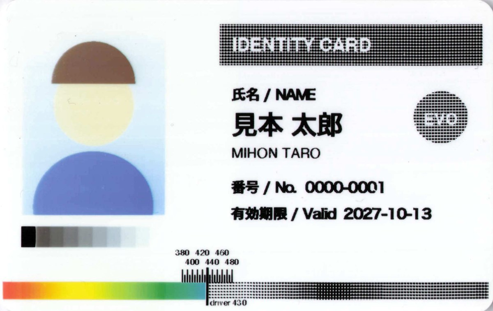

*v2.0 でプレビューの印刷ダイアログから、YMCKO ハーフパネルのリボン（R3013）で刷ったサンプルカード
（[samples/sample-card.pdf](samples/sample-card.pdf)）のスキャン。左側（約 36mm）がカラー、右側は黒パネルの網点で刷られる。*

## インストール

ターミナルは使わなくてよい。

1. [Releases](https://github.com/yukino1230/Evolis-Pebble-4-macOS-Driver/releases/latest) から `evolis-pebble4-<版>.pkg` を
   ダウンロードして、ダブルクリックで入れる（Developer ID で署名し、Apple の公証を通してある）
2. プリンタを USB でつないで、電源を入れる
3. 「システム設定」→「プリンタとスキャナ」→「プリンタを追加」を開き、種類が「**Bonjour**」の「**Evolis Pebble 4**」を選んで「追加」を押す。
   ドライバ欄にはプリンタの名前（Evolis Pebble 4）が出る。追加すると、種類は「Evolis Pebble 4-AirPrint」になる。
   種類が「USB」の「EVOLIS Pebble」は選ばない（プリンタ本体がそのまま見えているもので、選んでも刷れない）
4. アプリケーションフォルダの **Evolis Utility** を開き、「印刷の設定」タブで、付いているリボンを選ぶ
   （[リボンの種類](#リボンの種類pr)。違うリボンを選ぶと、カードが詰まったりリボンが切れたりする）
5. あとはふつうに刷る（[印刷のしかた](#印刷のしかた)）

Pebble 4 は片面専用の機種。黒（K）リボンと、カラー（YMCKO）リボンのハーフパネル（R3013）で実機確認済み。
ほかのリボン（全面パネルの YMCKO、KO、白・金などの単色）は設定を用意してあるが、実機では試していない。
macOS 27 / Apple Silicon で確かめた（Intel の Mac にも入るが、試していない）。

## 使い方

### 印刷のしかた

カードの大きさ（85.6 × 54mm、横長）で作った PDF や画像を、ふつうに印刷する。カードの全面に縁なしで刷られる。

- **プレビュー**：印刷ダイアログの用紙サイズが「その他（210 x 297 mm）」で開くので、毎回「積載用紙」の「**85.6x54mm**」を選ぶ
  （ターミナルの `evolis-setup` で登録したプリンタでは「85.6x54mm.Borderless」）。選び忘れると、刷らずにジョブが止まる
- **Pages・Word**：書類の「ページ設定」で、プリンタ「Evolis Pebble 4」と用紙 85.6 × 54mm を選んでおけば、そのまま刷れる
- 印刷ダイアログで選べるのは、部数、カラー / 白黒、品質など。リボンや濃さは Evolis Utility で決める

### Evolis Utility

プリンタの状態を見たり、印刷の設定を変えたり、本体の機能を呼んだりするアプリ。アプリケーションフォルダ（または Launchpad、Spotlight）から開く。

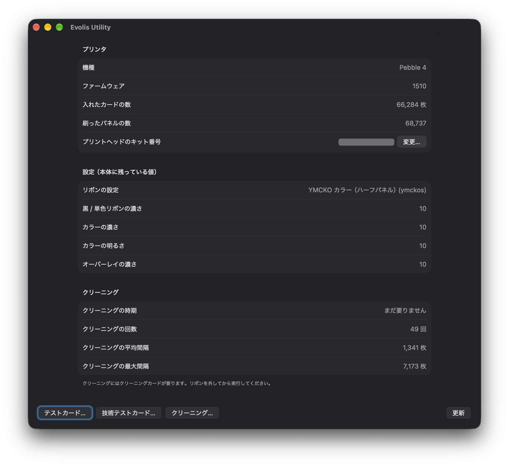 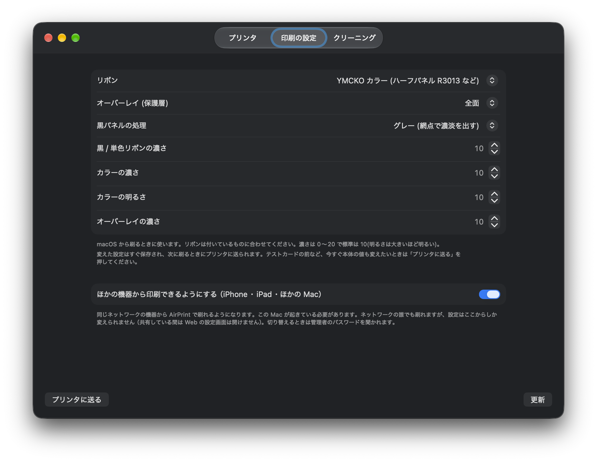

- **プリンタ**タブ：機種、ファームウェア、入れたカードの数、刷ったパネルの数、プリントヘッドのキット番号と、本体に残っている設定。
  「テストカード」「技術テストカード」で、プリンタが持っているテスト用のカードを刷る（カードを 1 枚使う）
- **印刷の設定**タブ：刷るときのリボン、オーバーレイ（保護層）の範囲、黒パネルの処理、濃さ。変えた値はすぐ保存され、次に刷るときに使われる。
  テストカードの前などに本体の値もそろえたいときは「プリンタに送る」を押す（カードは使わない）
- **クリーニング**タブ：クリーニングの時期と回数。「クリーニング」でクリーニングをする（リボンを外し、クリーニングカードを入れてから）

印刷中はプリンタが使用中なので、状態を読めない（「使用中」と出る）。終わってから「更新」を押す。

### リボンを付け替えたら

Evolis Utility の「印刷の設定」タブで、付けたリボンを選ぶ。違うリボンのまま刷ると、カードが詰まったりリボンが切れたりする
（ハーフパネルの R3013 に全面パネルの設定で刷ったときは、オーバーレイのリボンがカードに付いてきて、剥がそうとするとリボンが切れた）。
プリンタはどのリボンが付いているかを知らせないので、ドライバでは見分けられない。

### iPhone・iPad・ほかの Mac から印刷する（v2.1 から）

Evolis Utility の「印刷の設定」タブで「**ほかの機器から印刷できるようにする**」をオンにする（管理者のパスワードを聞かれる）。
同じネットワークの iPhone・iPad・ほかの Mac の「プリント」で「Evolis Pebble 4」を選べるようになる（AirPrint）。

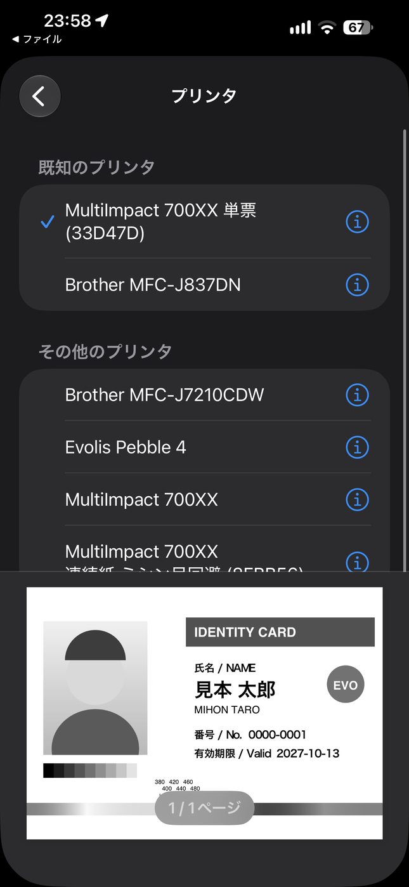 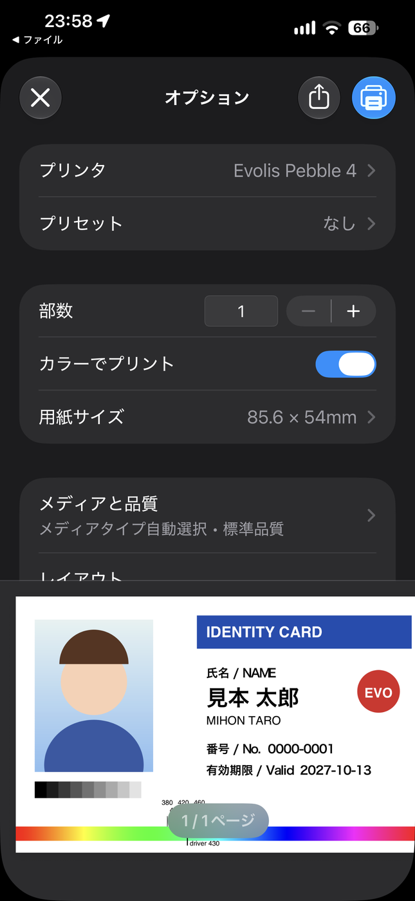

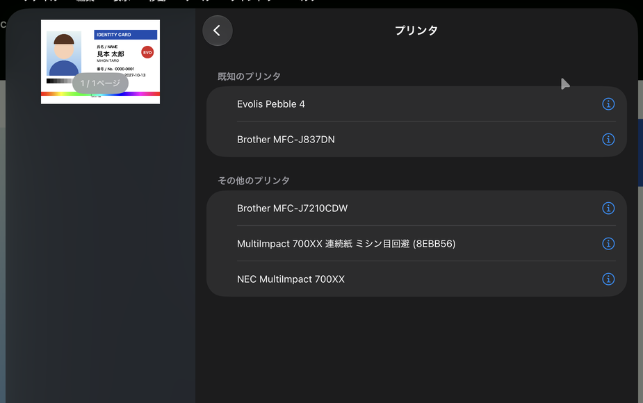 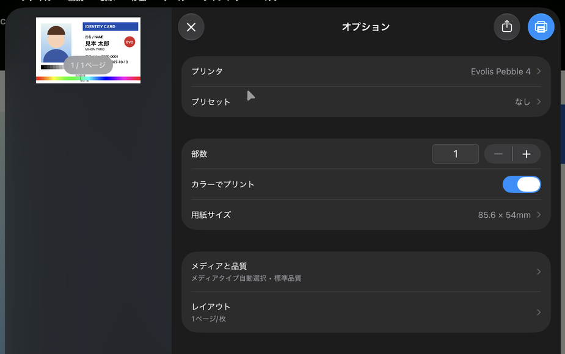

- iPhone・iPad では、用紙サイズは最初から「85.6 × 54mm」になる。選べるのは部数、カラーでプリント、メディアタイプ、プリント品質
- この Mac が起きていて、同じネットワークにいる必要がある
- ネットワークの誰でも刷れる。リボンや濃さなどの設定は、この Mac の Evolis Utility からだけ変えられる
- macOS のファイアウォールがオンでも、「ダウンロードした署名済みソフトウェアを自動的に許可」がオン（既定）なら通る
- 「プリンタとスキャナ」の「ネットワークでこのプリンタを共有」では、iPhone・iPad には出てこない（macOS は共有するプリンタを AirPrint として知らせない）。こちらはオフのままでよい

2026-10-15 に、iPhone と iPad から sample-card.pdf を刷って、どちらも Mac から刷ったものと同じカードが出ることを確かめた。

### プリントヘッドを交換したら

新しいヘッドの白いラベルにあるキット番号を、Evolis Utility の「プリンタ」タブの「プリントヘッドのキット番号」→「変更…」で書く
（ユーザーガイドの「プリントヘッドを交換する」の手順 3。Windows では公式ドライバの「プリンタダイアログ」で `Pkn;<番号>` を送るもの）。
間違えると正しく印刷できなくなるので、2 回入力して一致したときだけ送り、読み直して確かめる。設定したら、刷る前にクリーニングが要る。
キット番号にはヘッドのシリアルが入っているので、スクリーンショットを人に見せるときは隠す。

## ターミナルで使う

ターミナルからも、同じことができる。

### キューの登録（`evolis-setup`）

システム設定でプリンタを追加する代わりに、ターミナルで登録できる。

```bash
sudo evolis-setup --ribbon k                 # 登録して、既定のリボンを決める(k 黒 / ymckos ハーフパネルのカラー など)
sudo evolis-setup --share                    # iPhone・iPad・ほかの Mac と共有する(--no-share でやめる)
sudo evolis-setup --remove                   # キューを消す(--queue <名前> でほかの名前のキュー)
```

`--queue <名前>` でキューの名前を決められる（既定 `Evolis_Pebble_4`）。

### 印刷の設定（`evolis-printer-app`）

Evolis Utility の「印刷の設定」タブと同じことが、`evolis-printer-app` でできる（sudo は要らない）。値は PPD のオプションと同じ。

```bash
evolis-printer-app options -d "Evolis Pebble 4"                          # 今の設定(「(デフォルト)」の付いた行)
evolis-printer-app modify -d "Evolis Pebble 4" -o evolis-ribbon=ymckos   # リボンを変える
evolis-printer-app modify -d "Evolis Pebble 4" -o evolis-overlay=chipiso -o evolis-color-density=12
```

| 属性 | 値 |
|---|---|
| `evolis-ribbon` | `k` `ymcko` `ymckos` `ko` `kw` `kr` `kbl` `kgr` `kgo` `ksi` `ksc` `ka`（[リボンの種類](#リボンの種類pr)） |
| `evolis-overlay` | `full`（全面）/ `none` / `chipiso`（IC チップを避ける）/ `magstripe`（磁気ストライプを避ける） |
| `evolis-black-mode` | `gray`（網点）/ `line`（線画） |
| `evolis-black-density` `evolis-color-density` `evolis-color-brightness` `evolis-overlay-density` | 0〜20（標準 10。明るさは大きいほど明るい） |

### テストカードとクリーニング（`evolis-tool`）

```bash
evolis-tool test        # テストカード
evolis-tool techtest    # 技術テストカード
evolis-tool clean       # クリーニング(リボンを外し、クリーニングカードを入れてから)
```

### v1（PPD のドライバ）から移る

v2 の pkg を入れてから、今のキューと同じ名前で `evolis-setup` を実行すると、そのキューが Printer Application に切り替わる。

```bash
sudo evolis-setup --ribbon ymckos --queue EVOLIS_Pebble     # キューの名前は「プリンタとスキャナ」で見る
```

名前を指定しなければ `Evolis_Pebble_4` という新しいキューができる。その場合、前のキューは残る（`evolis-setup` が知らせる）ので、
使わなければ `sudo evolis-setup --remove --queue <名前>` で消す。システム設定で前のキューを消し、上の手順で追加し直してもよい。

### PPD のドライバで使う（v1 のやり方）

```bash
sudo evolis-setup --ppd --ribbon k
```

印刷ダイアログでリボンや濃さを選べる（Evolis Utility の「印刷の設定」は使わない）。付け替えたら
`sudo lpadmin -p Evolis_Pebble_4 -o EvolisRibbon=<種類>` で既定を変えるか、印刷ダイアログのプリセットにリボンごとの設定を保存しておく。
USB の送信が失敗したとき（ジョブの途中でプリンタの電源を切ったときなど）は、キュー全体を止めずにそのジョブだけ取り消す。
CUPS の PPD を使うドライバは将来の CUPS で廃止される予定なので、ふだんは Printer Application を使う。

## 入るもの

| 入るもの | 場所 |
|---|---|
| Evolis Utility | `/Applications/Evolis Utility.app` |
| Printer Application（Intel / Apple Silicon 両対応） | `/usr/local/libexec/evolis/evolis-printer-app`（`/usr/local/bin/evolis-printer-app` からも呼べる） |
| 自動で起動する設定 | `/Library/LaunchDaemons/jp.yukino.evolis-printer-app.plist` |
| 共有するかの設定 | `/Library/Application Support/evolis-printer-app.conf` |
| コマンド | `/usr/local/bin/evolis-setup`、`/usr/local/bin/evolis-tool` |
| CUPS フィルタと PPD（`--ppd` のとき使う） | `/usr/local/libexec/cups/filter/rastertoevolis`、`/usr/local/share/evolis/Pebble4.ppd` |
| 組み込んだライブラリのライセンス | `/usr/local/share/evolis/licenses` |

Printer Application は root で動き、Mac を起動したときから動いている。共有していないときは、この Mac の中（localhost）でだけ待ち受ける。
プリンタと設定は `/private/var/lib/evolis-printer-app.state`、ログは `/Library/Logs/evolis-printer-app.log`（`sudo` で読む）に残る。

### アンインストール

```bash
sudo evolis-setup --remove           # キュー(システム設定で追加した場合は、そこで削除する)
sudo launchctl bootout system/jp.yukino.evolis-printer-app
sudo rm -f /Library/LaunchDaemons/jp.yukino.evolis-printer-app.plist /usr/local/bin/evolis-printer-app \
           "/Library/Application Support/evolis-printer-app.conf" \
           /usr/local/libexec/cups/filter/rastertoevolis /usr/local/bin/evolis-setup /usr/local/bin/evolis-tool \
           /Library/Printers/PPDs/Contents/Resources/EvolisPebble4.ppd.gz /Library/Logs/evolis-printer-app.log \
           /Library/Logs/evolis-printer-app.log.O /private/var/run/evolis-printer-app.sock
sudo rm -rf /usr/local/libexec/evolis /usr/local/share/evolis "/Applications/Evolis Utility.app" \
            /private/var/lib/evolis-printer-app.state /private/var/spool/evolis-printer-app
sudo pkgutil --forget jp.yukino.evolis-pebble4
```

### 自分でビルドする

Xcode のコマンドラインツール（`xcode-select --install`）と python3 が要る。

```bash
./driver/build-pkg.sh 2.1.3            # build/pkg/evolis-pebble4-2.1.3.pkg ができる
sudo driver/install.sh --ribbon k      # PPD のドライバだけを、pkg を作らずにその場でビルドして入れる（開発用）
```

Printer Application は [PAPPL](https://www.msweet.org/pappl/) 1.4.12 と [LibreSSL](https://www.libressl.org/) 4.3.3 を
組み込んで（静的にリンクして）作る。`build-pkg.sh` が初回に `printer-app/build-deps.sh` を呼び、
両方をソースからビルドする（SHA-256 を確かめてからダウンロードする。2 分ほどかかる）。
Printer Application だけを作るときは `printer-app/build.sh`、Evolis Utility だけを作るときは `app/build-app.sh`。

`build-pkg.sh` は Developer ID 証明書があれば自動で署名する（無ければ未署名のまま作る）。
`EVOLIS_NOTARY=<notarytool のプロファイル名>` を付けると公証まで行う。

刷り方にかかわるところを変えたら、刷られる内容が変わっていないかをテストで確かめる（プリンタは要らない）。

- `tests/run.sh`: CUPS フィルタ。テスト用のラスタ 9 種類とオプションの組み合わせ 24 通りで、プリンタに送るバイト列を前と比べる。
  刷り方を意図して変えたときは `tests/run.sh --update` で記録し直す
- `tests/printer-app.sh`: Printer Application。出力先がファイルのプリンタを作って IPP でジョブを送り、16 通りが
  CUPS フィルタと 1 バイトも違わないこと、プリンタの既定値で刷られること、印刷ダイアログと同じ形のジョブを受け付けることを確かめる

## 分かっていること（2026-10-13 時点の調査）

| | |
|---|---|
| コマンドリファレンス | **公式の Evolis Card Printers Programming Guide A5013** が New Pebble / Tattoo / Dualys / Quantum / Kiosk をカバー。**このリポジトリで「A5013」と書いているのは Rev.E**（手元の PDF。著作物なので公開していない）。ネット上には [Rev.D2](https://www.yumpu.com/en/document/view/54519120/new-pebble-programming-guide-a5013-revd2/9)（表紙が "NEW PEBBLE PROGRAMMING GUIDE"）や [Qu2 版](https://idoc.pub/documents/programming-guide-evolis-qu2-en5k9g7wqpno)の写しがある |
| 公式 Linux ドライバ | 2014年12月に **Pebble 2 / 3 / 4** を含む世代向けの RPM / DEB が出ている（現在はレガシー扱い） |
| 公式 macOS ドライバ | [現行の互換性表](https://www.evolis.com/wp-content/uploads/2022/05/Drivers-Compatibility-Chart-ENG.pdf)に **Pebble の行は無い** |
| オープンソースの実装例 | [dpavlin/Printer-EVOLIS](https://github.com/dpavlin/Printer-EVOLIS)（Dualys 3 向け、Perl、GPLv2+）。実際に送るバイト列が読める |
| 接続 | **USB プリンタクラス**（Windows が `USBPRINT\EVOLISPEBBLE…` として認識する）。macOS でも生バイトを流せるはずで、カーネル拡張は要らない |

### コマンドの形

`ESC` + ASCII + `CR`。[`evolis-driver.pl`](https://github.com/dpavlin/Printer-EVOLIS/blob/master/scripts/evolis-driver.pl) より:

```
ESC Pr;k      CR   リボン: 黒
ESC Pmi;F;s   CR   挿入モード
ESC Pc;k;=;10 CR   コントラスト
ESC Ss        CR   シーケンス開始
ESC Sr        CR   表面
ESC Db;k;2;<ビットマップ> CR   ビットマップ送信(1bit パック)
ESC Sv        CR   裏面
ESC Se        CR   シーケンス終了
+ 0x00 x 64 のパディング
```

問い合わせ系（[`evolis-command.pl`](https://github.com/dpavlin/Printer-EVOLIS/blob/master/scripts/evolis-command.pl) より）。**カードもリボンも使いません**:

| コマンド | 返るもの |
|---|---|
| `ESC Rtp CR` | プリンタの機種名 |
| `ESC Rfv CR` | ファームウェアのバージョン |
| `ESC Rsn CR` | シリアル番号 |
| `ESC Rco;p CR` | 刷ったパネルの数（カウンタ） |

## 実機で確かめたこと（2026-10-13）

| | |
|---|---|
| USB | VID `0x0F49` / PID `0x0100`、bcdDevice `0x0602`。インターフェース 0 がプリンタクラス（class 7 / protocol 2 = 双方向、bulk OUT/IN）。CUPS からは `usb://EVOLIS/Pebble?location=20100000` |
| 別のポート | 挿し直すと CUPS の URI の `location` が変わる（`20100000` → `20200000`）が、キューは古い URI のままで印刷できた（macOS の CUPS がメーカー名と機種名で見つけている）。USB のシリアル番号は空 |
| 通信 | macOS は class 7 を掴まないので、libusb（pyusb）でそのまま claim できる |
| 返事の形 | ASCII + `\0` 終端。**次のコマンドを送るまで、IN を読むたびに同じ返事が繰り返し返ってくる**ので最初の `\0` で切る |

[`tools/evolis_query.py`](tools/evolis_query.py) の結果:

| コマンド | 返事 |
|---|---|
| `Rtp` | `Pebble 4` — A5013 のコマンド体系がそのまま通る |
| `Rfv` | `1012` |
| `Rsn` | `PB0839xxxxxxx` |
| `Rco;l` | `2`（`l` は A5013 に載っていないオプション。意味は不明。別の日に読むと応答が無かった） |
| `Rco;p` / `Rco;c` | `68675` / `66262`（刷ったパネルの数 / 入れたカードの数） |
| `Rco;a` / `Rco;m` / `Rco;n` | `1341` / `7173` / `49`（クリーニングの平均間隔 / 最大間隔 / 回数） |
| `Rx` / `Ry` | `17` / `15`（印刷位置の横・縦のオフセット。`Px` / `Py` で変えられる） |
| `Rmi` | `Feeder`（カードはフィーダーから入れる。`Pmi` で変えられる） |
| `Rkn` | `411-D85xxxxx-D`（印字ヘッドのキット番号。先頭 3 桁がヘッドの抵抗値 ×10） |
| `Rse` | `ERROR CDE` — 未知コマンドはこの形で返る |

```bash
python3 -m venv .venv && .venv/bin/pip install pyusb
.venv/bin/python tools/evolis_query.py            # Rtp Rfv Rsn Rco;p
.venv/bin/python tools/evolis_query.py "Rr;p" "Rc;k"
```

### 片面・黒の印刷（2026-10-13 成功）

[`tools/evolis_print.py`](tools/evolis_print.py) が送るのは次の最小構成。`Pmi`（挿入モード）と `Pc`（コントラスト）は送らず、本体の既定値で通った。

```
ESC Pr;k CR
ESC Ss CR
ESC Sr CR
ESC Db;k;2;<82296 バイト> CR
ESC Se CR
0x00 x 64
```

- 画像はカード全面 **1016×648 ドット（300dpi、横長）**
- 時計回りに 90° 回したものを送る。1 行が 648 ドット = 81 バイトで、それが 1016 行。MSB が先で **1 = 黒**
- この向きで、画面で見たままカードに刷られた（上下左右の反転なし）

```bash
.venv/bin/pip install pillow
cd tools
../.venv/bin/python make_testcard.py /tmp/testcard.png
../.venv/bin/python evolis_print.py /tmp/testcard.png --send
```

### カラー（YMCKO）の印刷（2026-10-13、ツールから成功）

A5013（Rev.E）と
[qz-tray の実装](https://github.com/qzind/tray/blob/master/src/qz/printer/action/raw/converter/Evolis.java)に従った形で刷れた。

```
ESC Pr;ymckos CR                    リボン（R3013 ハーフパネルなら ymckos、全面パネルなら ymcko）
ESC Ss CR
ESC Sr CR
ESC Db;y;32;<411480 バイト> CR      Y/M/C は 1 ドット 5bit をビット単位で詰める（MSB が先）。値はインク量で 0 = 塗らない
ESC Db;m;32;<411480 バイト> CR
ESC Db;c;32;<411480 バイト> CR
ESC Db;k;2;<82296 バイト> CR        黒（樹脂）は 1bit
ESC Db;o;2;<82296 バイト> CR        オーバーレイ。1 = 保護層を乗せる
ESC Se CR
```

- ドットの並びは黒と同じ（カードを時計回りに 90° 回し、1 行 648 ドット × 1016 行）
- **`Pr` で設定したリボンの種類は本体に保存される。** `Rr;p` で読める。公式の古いドライバは `Pr;<リボン>;t` も送っていたが、
  ファームウェア 1012 では `ERROR PARAMETRES` だった。1510 では受け付けたが、電源を入れ直しても設定は残った
  （一時的に設定する形ではない）ので、ドライバは `t` を付けない
- **リボンの種類を間違えると、カードが詰まったりリボンが切れたりする。** ハーフパネルの R3013 に `ymcko` を送ったら、
  印刷途中で止まった。オーバーレイ（保護層）のリボンがカードに付いてきて、剥がそうとするとリボンが切れた
- **ハーフパネル（R3013）で色が乗るのはカードの左側だけ。** 左端から約 43%（約 435 ドット）。黒とオーバーレイは全面。
  A5013 にはハーフパネル用の部分ダウンロード `Dbp`（最大 420 行）と開始位置の `Psp` / `Rsp` があるが、ドライバは全面の `Db` を
  送り、色を乗せる幅を 430 ドットにしている（サンプルカードで 430 まで色が欠けずに出ることを確かめた）
- A5013 の `Db` の説明にはデータの大きさが 84,624 / 423,120 バイトと載っているが、同じページの式
  （648 × 1016 × ビット数 ÷ 8）で出る 82,296 / 411,480 バイトで刷れている
- ほぼ黒の無彩色（RGB の各値が 24 未満、差も 24 未満）だけを黒パネルに回し、それ以外は Y/M/C で刷る
- **ドライバは Y/M/C を 128 段階（`Db;y;128`、1 ドット 7bit、1 パネル 576,072 バイト）で送る。** 上の例は最初に試した 32 段階。
  C / M / Y / グレーのグラデーションを 32 段階と 128 段階で 1 枚ずつ刷って比べると、128 段階の方が段差が小さかった
  （帯に沿った明るさのずれの標準偏差: グレー 1.45 → 1.05、マゼンタ 0.94 → 0.71。イエローとシアンはほぼ同じ）。
  公式の古い macOS 用フィルタも 128 段階で送る処理を持っている。32 段階に戻すには、ジョブに `EvolisColorLevels=32` を付ける

  | 32 段階 | 128 段階 |
  |---|---|
  | 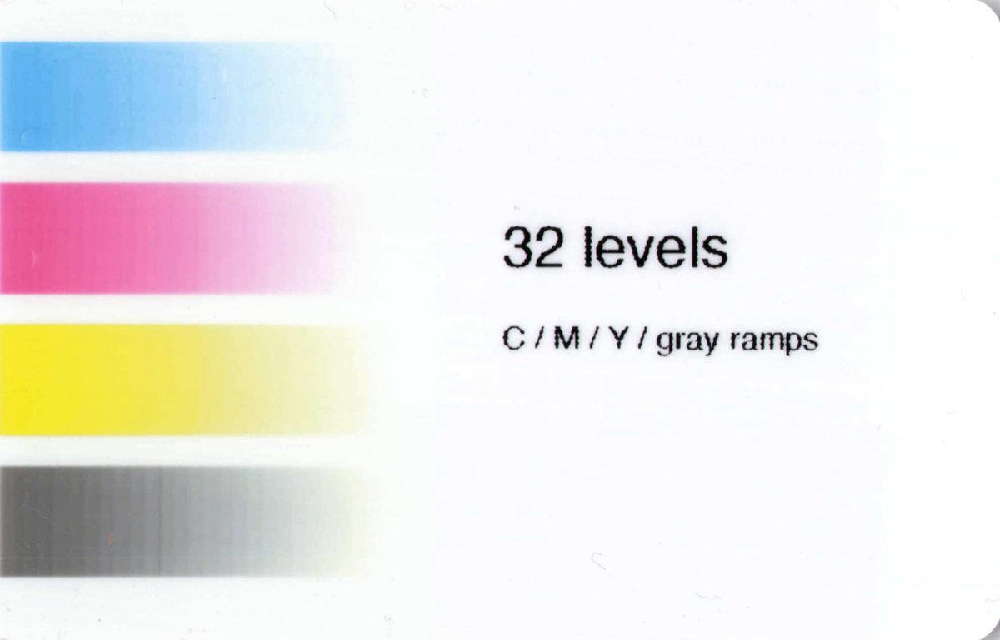 | 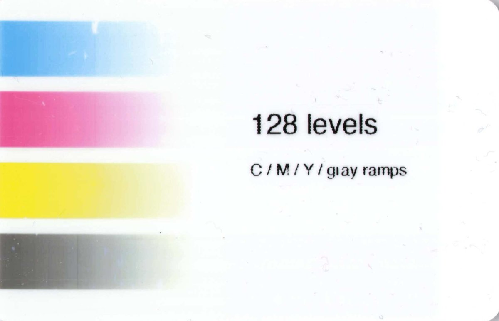 |
- **黒パネルの網点は、点を散らす誤差拡散だと 60% 前後で真っ黒に潰れる**（樹脂の黒が 1 ドットごとににじむ）。
  点を中心から太らせる 6×6 の網点（50 線）にして、[目盛りカード](tools/make_halftone_cal.py)で測った補正をかけている。
  R3013 の黒パネルで刷って測った結果（指定 % → 見た目の %）:

  | 指定 | 10 | 20 | 30 | 40 | 50 | 60 | 70 | 80 | 90 |
  |---|---|---|---|---|---|---|---|---|---|
  | 誤差拡散（補正なし） | 8 | 14 | 40 | 74 | 53 | 101 | 106 | 106 | 106 |
  | 6×6 網点、指定^1.6 | 0 | 10 | 17 | 30 | 47 | 63 | 76 | 92 | 103 |

  | 誤差拡散（最初の版） | 6×6 の網点 |
  |---|---|
  | 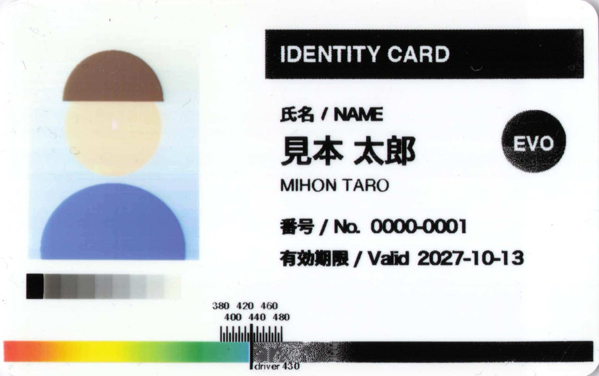 | 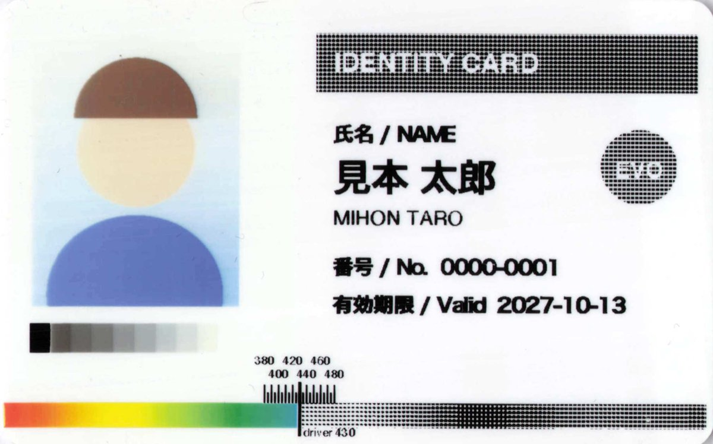 |

  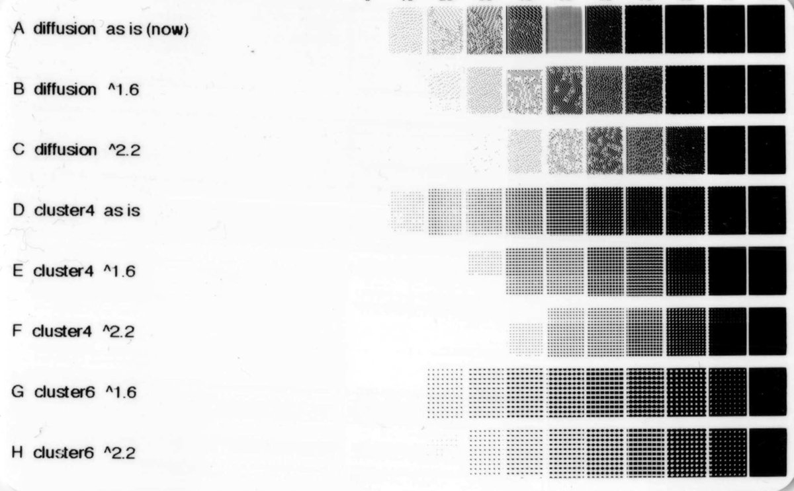

  *点の打ち方と補正を変えて 0〜100% を並べた目盛りカード。A〜C は誤差拡散、D〜F は 4×4、G・H は 6×6 の網点。
  素直に濃くなっていくのは G 行。*
- **黒の単色リボンは、カラーリボンの黒パネルよりにじみが少ない。** カラーリボン用の補正のまま刷ると、
  暗いグレー（56〜89%）が 10〜15 ポイント明るく出た。黒リボンで 6×6 網点を補正なしで 5% 刻みに刷り
  （`make_halftone_cal.py --set linear --ribbon k`、4 回ずつ）、グレースケールでスキャンして測った:

  | 網点の量 | 10 | 20 | 30 | 40 | 50 | 60 | 70 | 80 | 90 |
  |---|---|---|---|---|---|---|---|---|---|
  | 黒リボン（見た目の %） | 11 | 24 | 36 | 46 | 60 | 75 | 81 | 91 | 96 |

  補正後にサンプルカードの 10 段のグレーを測った結果（黒リボン、濃さ 10）:

  | 指定 | 100 | 89 | 78 | 67 | 56 | 44 | 33 | 22 | 11 | 0 |
  |---|---|---|---|---|---|---|---|---|---|---|
  | 補正前（カラー用の表） | 100 | 74 | 63 | 52 | 43 | 36 | 29 | 22 | 10 | 0 |
  | 補正後（黒リボン用の表） | 99 | 86 | 77 | 61 | 52 | 43 | 32 | 22 | 11 | 1 |

  ドライバは、カラーリボンの黒パネルと単色リボン（黒・白・金など、KO）で補正表を使い分ける。
  単色リボンの黒以外と KO は、黒リボンと同じと仮定している。
  **スキャンは必ずグレースケール（またはカラー）で。** 白黒 2 値で取り込むと網点が太って記録され、
  10% が 21%、50% が 71% のように大きく濃く測れてしまう
- 黒パネルでは、色は明るさだけのグレーにして網点で刷る（真っ黒は黒ベタ）。濃さ 60% 以上を黒ベタに
  切り替える版も試したが、グラデーションが途中で急に黒ベタになるのでやめた。
- **ハーフパネルのリボンでカードを作るときは、色を使う部分を左側（約 36mm）に置き、右側は黒と白だけで作る。**
  右側の色はグレーの網点になる（たとえば濃い青の帯は濃さ 72% の網点）。黒ベタで出したい部分は、
  ドライバに任せずデザインの段階で黒にしておく

```bash
cd tools
../.venv/bin/python make_colorcard.py /tmp/colorcard.png
../.venv/bin/python evolis_print.py /tmp/colorcard.png --ribbon ymckos --send
```

### リボンの種類（`Pr`）

この Pebble 4 は、A5013 に載っているコードを小文字ならすべて受け付けた（`Pr` で設定して `Rr;p` で読み戻した）。
大文字の `Ktc` などは `ERROR PARAMETRES`。

型番と 1 巻の枚数は、カーデックス（cardex.jp）の[サプライ一覧](https://www.cardex.jp/supply/list/)（ぺブル PBL-4 用、2026-10-13 時点）による。

| `Pr` の値 | `Rr;p` の返事 | 型番（1 巻の枚数） | 送るパネル | ドライバ | 実機 |
|---|---|---|---|---|---|
| `k`（`kb` も同じ） | k Black | R2011 黒（1,000 枚） | K | ✅ | ✅ |
| `kbl` | k Blue | R2012 青（1,000 枚） | K | ✅ | 未確認 |
| `kr` | k Red | R2013 赤（1,000 枚） | K | ✅ | 未確認 |
| `kgr` | k Green | R2014 緑（1,000 枚） | K | ✅ | 未確認 |
| `kw` | k White | R2015 白（1,000 枚）、R2030 白サインパネル（1,000 枚、`kw` でよいかは推測） | K | ✅ | 未確認 |
| `kgo` | k Gold | R2016 金（1,000 枚） | K | ✅ | 未確認 |
| `ksi` | k Silver | R2017 銀（1,000 枚） | K | ✅ | 未確認 |
| `ksc` | k Scratch | R2018 スクラッチオフ（1,000 枚） | K | ✅ | 未確認 |
| `ka` | k Wax Plastic | 一覧に無い（Pebble 用は見つからない。下を参照） | K | ✅ | 未確認 |
| `ymcko` | ymcko | R3011（200 枚） | Y M C K O | ✅ | 未確認 |
| `ymckos` | ymckos | R3013 ハーフパネル（400 枚） | Y M C K O（Y/M/C は左側だけ） | ✅ | ✅ |
| `ko` | ko | R3012 黒＋オーバーコート（500 枚） | K O | ✅ | 未確認 |
| `ymckok` | ymckok | R3314（200 枚）。**Pebble 非対応**（[データシート](https://fr.evolis.com/wp-content/uploads/2024/01/datasheet-ymckok-eng.pdf)の対応機種は SECURION / QUANTUM2） | — | 見送り | |
| `h` `ho` | h | R4002 ホログラム（350 枚）。**Pebble 非対応**（[データシート](https://fr.evolis.com/wp-content/uploads/2026/03/datasheet-generic-holo-varnish-eng.pdf)の対応機種は QUANTUM2 / SECURION） | — | 見送り | |
| `ktc` `ktp` | k Direct Thermal Card / Paper | リボンを使わない | — | 見送り（専用カードに直接刷る） | |

R3314 と R4002 はカーデックスの一覧では PBL-4 用に載っているが、上のとおり Evolis のデータシートでは Pebble 用になっていない。

カーデックスの一覧の PBL-4 用には、ほかに次の 2 つがある。Evolis のデータシートで確かめた:

- **R2030 White Signature**（[データシート](https://fr.evolis.com/wp-content/uploads/2023/12/datasheet-white-signature-eng.pdf)）:
  ペンで署名できる白い四角（サインパネル）を刷る単色リボン。対応機種に PEBBLE / DUALYS がある。
  `Pr` の値は書かれていないので、白の単色リボンとして `kw` で刷るのが妥当と推測（黒く描いたところに白い署名欄が乗る）
- **R2029 BlackFLEX**（[データシート](https://www.evolis.com/wp-content/uploads/2023/04/datasheet-blackflex-eng.pdf)）:
  ABS・PET・PC・表面の粗い PVC・紙のカード向けの黒の単色リボン。**データシートの対応機種は SECURION と QUANTUM2 だけで、
  Pebble は載っていない**（カーデックスの一覧とは食い違う）。用途は `ka`（ABS などのカード向けの黒ワックス）に近いが、`Pr` の値は不明

黒ワックス（`ka`、`k Wax Plastic`）のリボンは、型番 **R2139 BlackWAX**（3,000 枚）が見つかったが、販売店の表記では
対応機種は Quantum 2（店によっては初代 Quantum も）で、Pebble 用ではない。Pebble のリボンは 1 巻 1,000 枚なので、巻の大きさも違う。
販売店によって「販売終了、後継品なし」と書くところと、まだ載せているところがあり、今も買えるかははっきりしない（2026-10 時点）。
Pebble 用の黒ワックスのリボンは見つからなかったので、`ka` は A5013 にあるから受け付けているだけで、使う場面は無いと思われる。

どちらのデータシートにも、単色リボンは連続リボンで、刷った部分（＋7mm）だけを使う「ribbon saver」の機能がある、とある（プリンタ側の機能）。

単色リボンはどれも K パネル 1 枚で、**画像の暗いところにリボンの色が乗る**（白リボンなら、黒く描いたところが白く刷られる）。
未確認のものは、A5013 の書き方からの推測で送っている。

**付いているリボンの種類は、プリンタからは分からない。** この世代の Pebble にはリボンを見分けるチップ（RFID）が無く、
`Rr` / `Rr;p` が返すのは `Pr` で設定された値だけ。A5013 にも種類を自動で見分ける記述は無い。
ほかのリボン関係の読み取りも、種類の手がかりにはならなかった（2026-10-13、R3013 装着時）:

| コマンド | 返事 | 意味（A5013） |
|---|---|---|
| `Rr` | `ymckos` | 本体のメモリに設定された種類 |
| `Rcr` | `OK` | リボン末尾の黒マークの上にいない（カラーリボンのとき） |
| `Rrs` | `S D` | リボンの大きさの扱い（`S` = 200 枚用、`L` = 1000 枚用。巻き取りの電圧用） |
| `Rro` | `552 588 38` | リボン位置のオフセット |
| `Rsp` | `0 0` | ハーフパネル用の印刷開始位置 |
| `Rco;l` | `2` | `l` は A5013 に載っていない（残り枚数の目安は `Rco;I`。ファームウェア 1012 では `ERROR PARAMETRES`、1510 では `1000`） |
| `Rrm` | 応答なし | |

**リボンを付け替えたら、利用者がドライバのリボンを合わせる。** 合っていないと、カードが詰まったりリボンが切れたりする
（ハーフパネルの R3013 に `ymcko` を送ったときは、オーバーレイのリボンがカードに付いてきて、剥がそうとするとリボンが切れた）。切り替え方:

- **Printer Application**（v2.0 の標準）: Evolis Utility の「印刷の設定」タブでリボンを選ぶ。
  ターミナルなら `evolis-printer-app modify -d "Evolis Pebble 4" -o evolis-ribbon=ymckos`

PPD のドライバ（`--ppd`）のとき:

- **印刷ダイアログのプリセット**（おすすめ）: リボンを選んで「プリセット」→「現在の設定をプリセットとして保存」。
  「カラー（ハーフパネル）」「白」などで保存しておけば、プリセットを選ぶだけで切り替わる
- **キューの既定を変える**（インストールし直さなくてよい）:

  ```bash
  sudo lpadmin -p Evolis_Pebble_4 -o EvolisRibbon=ymckos
  ```

### 印刷ダイアログの用紙サイズ

**プレビュー.app で PDF を刷るときは、印刷ダイアログの用紙サイズが「その他（210 x 297 mm）」で開く。毎回「カード CR80」
（Printer Application では「積載用紙」の「85.6x54mm」、`evolis-setup` で登録したキューでは「85.6x54mm.Borderless」）を選ぶ。**

**Pages と Word では、書類の「ページ設定」でプリンタ「Evolis Pebble 4」・用紙「カード CR80」を選んでおけばよい**
（どちらも印刷ダイアログには用紙サイズの欄が無く、書類のページ設定がそのまま使われる。どちらも実機で確認）。

- 最初の用紙サイズは、アプリのページ設定（プレビュー.app では macOS 全体の既定の用紙 = A4）から来る。
  このプリンタに A4 は無いので「その他」になる
- CR80 は CUPS の標準の用紙名に無く、CUPS は `custom_54x85.6mm_54x85.6mm` として macOS に伝える。
  標準の用紙として扱わせる手は見つからなかった（Brother のラベルプリンタも同じで、専用のダイアログ拡張で対処している）
- 用紙を縦長（54×85.6mm）で定義し直しても変わらなかった
- プリセットに用紙サイズを保存して選んでも、プレビュー.app は次に開くと「デフォルト設定」に戻る
- AirPrint（IPP Everywhere）のプリンタとして「セットされている用紙は CR80」（`media-default` / `media-ready`）と
  名乗らせても、プレビュー.app は「その他（210 x 297 mm）」で開いた（`ippeveprinter` でテスト用のプリンタを立てて確認）。
  プリンタ側から最初の用紙を変える手段は無さそうなので、Brother のような印刷ダイアログ拡張（PDE）も作っていない
- Pages と Word は書類のページ設定の用紙で刷る

**選び忘れて「その他」のまま刷ると、白紙のカードが 1 枚出ていた。** アプリは A4 のページを作り（カードの絵柄は
その真ん中）、macOS は用紙だけ CR80 に置き換えて送ってくる（ジョブの `media` は `CR80`）。ラスタには A4 の左下の
カード 1 枚分が切り出されるので真っ白になる。

そこでドライバは**真っ白なページを刷らない**。ジョブ全体が真っ白なら、カードを送らずに止めて、キューに
「印刷する内容がありません。印刷ダイアログで用紙サイズを「カード CR80」にしてください」と出す。
ドライバ（フィルタ）が止めたジョブは、CUPS の決まりで「停止中」になるだけで、プリンタ自体は止まらない（次のジョブは普通に刷れる）。
キューの `printer-error-policy` は USB の送信処理（バックエンド）が失敗したときにだけ使われ、フィルタの失敗には関係しない
（[CUPS の `scheduler/job.c`](https://github.com/apple/cups/blob/master/scheduler/job.c) の `finalize_job`）。
止めたジョブは「停止中」としてメッセージ付きでキューに残るので、「×」で消す（「↻」で再開しても同じ理由でまた止まる）。
（カードより大きいラスタが届いた場合も止める。`lp` で大きい用紙を直接指定されたときの保険）

### カードが無いとき

**フィーダーにカードが無い（外れている）と、ジョブは「プリント中」のまま止まる。** プリンタはカードが来るまでデータを
受け取らず、カード切れを Mac に知らせる仕組みも無い（キューに理由は出ない）。カードが無い状態で `Rlr;p` を読んでも `OK` だった。

- **刷りたいとき**: カードを入れれば、そのまま刷られる
- **やめたいとき**: キューで取り消しても止まらない（CUPS の USB の送信処理が書き込みの途中で止まったまま残り、
  データの一部はもうプリンタに渡っている）。**取り消してから、カードを入れる前にプリンタの電源を入れ直す**。
  入れ直さずにカードを入れると、残ったデータで 1 枚刷られてしまう

カードの入れ方は本体の設定（`Rmi` で読める。この機体は `Feeder`）で決まり、ドライバは `Pmi` を送らない。
`Pmi;F`（フィーダー）と `Pmi;M`（手差し）は受け付けて `Rmi` が `Feeder` / `Manual` に変わった。`Pmi;B`（中に無ければ
フィーダー）は `ERROR PARAMETRES`。

**フィーダーを付けたまま `Pmi;M`（手差し）で刷ると、カードがフィーダー側に戻って詰まり、エラーになった。** そのあと
電源を入れ直さずに `Pmi;F` に戻しても、カードが戻ったりして正常に刷れなかった。**電源を入れ直したら元に戻った。**
印刷ダイアログに「給紙（フィーダー / 手差し）」を付けてみたが、手差しカートリッジ（オプション）が手元に無く手差しを
確かめられないこと、フィーダーで手差しを選ぶと被害が大きいこと、macOS が自動で足す「自動選択」と「本体の設定のまま」が
同じ動きで意味が無いことから、外した。**手差しカートリッジを付けたときの振る舞いは未確認**（カードが無いときにどうなるかも）。

### オーバーレイの範囲

保護層（O パネル）を乗せない範囲を選べる。避ける範囲はカードの規格から決めた（カードの表の左上から）:

| 選択肢 | 乗せない範囲 | 根拠 |
|---|---|---|
| なし | 全面 | 刷ったあとに書き込むカード、別にラミネートするカード向け |
| IC チップを避ける | 横 8.5〜21.5mm、縦 17.5〜30.5mm | ISO 7816-2 の接点（横 10.25〜19.87、縦 19.23〜28.55）にモジュールの大きさ分を足した |
| 磁気ストライプを避ける | 縦 5.0〜17.6mm、全幅 | ISO 7811 のストライプ（縦 5.54〜15.82）に余裕を足した。[qz-tray](https://github.com/qzind/tray/issues/269) の例の範囲とも合う |

公式の古いドライバにあった「IC チップを避ける（AFNOR）」は、寸法が分からないので入れていない。
「IC チップを避ける」でサンプルカードを刷ると、狙った位置に保護層の無い四角ができた（光にかざすと見える。
保護層が無い部分は色が浅く見える）。「磁気ストライプを避ける」も、上端から 5mm と 17.6mm のところで反射の具合が変わり、
狙った位置に保護層の無い帯ができた（表面に刷って確かめた）。「なし」で刷ると、オーバーレイのパネルのところで
印刷中の音が変わった（保護層を乗せていない）。PVC のカードはもともとつやがあるので、見た目では見分けにくい。

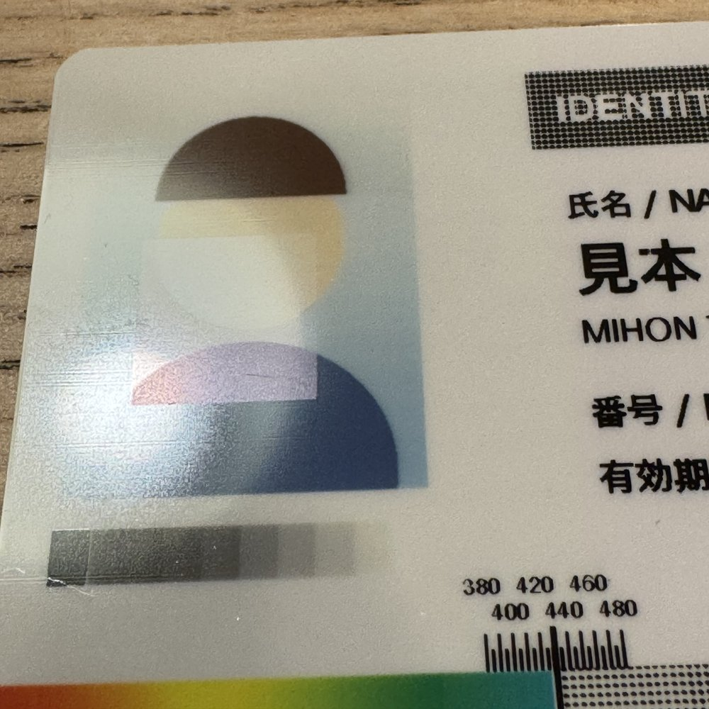

*「IC チップを避ける」で刷ったカードを、光にかざして撮ったもの。顔から肩にかけての四角（左端から約 8.5〜21.5mm、
上端から約 17.5〜30.5mm）に保護層が無く、色が浅く見える。*

### カラーの明るさ（`Pl`）と黒パネルの線画モード

公式の古いドライバにあった「Brightness（Luminosity）」と「Effect: Gray / Line Mode」に当たるものを足した。

- サンプルカードを `Pl;a;=;14` で刷り、`Pl;a;=;10` のカードと左側の色を比べると、**どこも 1〜2 割暗くなった**
  （明るさ 0〜255 で、顔 213 → 201、服 131 → 114、グレー 95 → 78。白地は 252 → 254 で変わらない）。
  本体の `Pl` は名前と逆に、値を上げるほどインクが濃く乗る。そこで印刷ダイアログの「カラーの明るさ」は
  **大きいほど明るくなるように、`20 − 値` を送る**（標準の 10 は 10 のまま）
- 線画モードでは、見出しの帯やロゴのような濃い色は黒ベタ、明るい色は白になり、網点の上の白抜き文字もくっきり出る
  （以前「60% 以上を黒ベタ」にして既定からは外した処理を、選べる形にしたもの）

  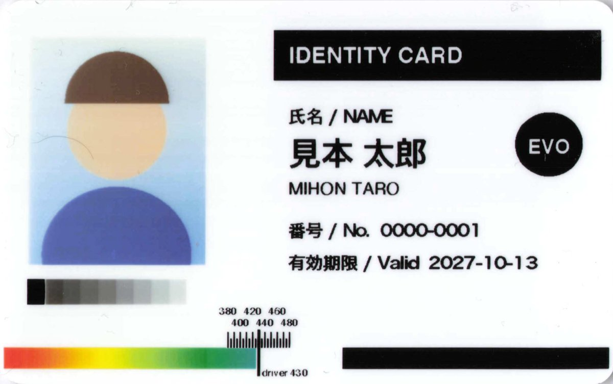

  *線画モード（とカラーの明るさを暗くする向き）で刷ったもの。上のサンプルカード（グレー）と比べると、見出しの帯とロゴが黒ベタになっている。*

### テストカードと `evolis-tool`

本体が持っているテストカードとクリーニングは、pkg に入る `evolis-tool` で呼べる（印刷キュー経由で 1 行のコマンドを送るだけ。
sudo も Python も要らない。キューは USB の Evolis につながっているものを自動で探す）。

```bash
evolis-tool test        # テストカード（St）
evolis-tool techtest    # 技術テストカード（Stt）
evolis-tool clean       # クリーニング（Scp）。リボンを外し、クリーニングカードを入れてから
```

- テストカードには Evolis のロゴと機種・シリアル番号などが刷られる。ハーフパネルのリボンだと、ロゴの右側の色は切れる
- 技術テストカードには、シリアル番号、ヘッドの番号、ファームウェア、印刷位置のオフセット（X-Y-Smart: `17 - 15 - 410`）、
  **実際に印字する範囲（Printed Lines L/W: `995 L / 636 W`）**、入れたカードの数、クリーニングの回数が刷られる。
  送っているデータは 1016 × 648 だが、本体が印字するのは 995 ライン × 636 ドット（約 84.2 × 53.8mm）らしい
- どちらのカードにもシリアル番号などが刷られるので、スキャンを公開するときは注意
- `evolis-tool clean` はクリーニングカードが無いので実機で試していない

### ファームウェア 1012 と 1510 の違い

Windows で公式の書き込みアプリを使って 1012 → 1510 に更新し、[`tools/evolis_probe.py`](tools/evolis_probe.py) で前後を比べた。
読み取りコマンド（`R` ＋ 小文字 0〜3 文字と、1510 のファームウェアにある名前）を総当たりし、`ERROR CDE` 以外を返すものを数えた。
設定を変えるコマンド（`P` / `S` / `W` / `M`）は、本体に保存されたりカードが動いたりするおそれがあるので総当たりしていない。

| | 1012 | 1510 |
|---|---|---|
| 返事のある読み取りコマンド | 112（うち A5013 に無いもの 79） | 136（24 増えた。減ったものは無い） |
| `Rck`（ファームウェアのチェックサム） | `E37F` | `28B6`（書き込みアプリの中のファームウェアのヘッダの値と同じ） |
| `Pr;<リボン>;t` | `ERROR PARAMETRES` | `OK`（ただし設定は電源を入れ直しても残る） |
| `Rco;I`（あと何枚刷れるかの目安） | `ERROR PARAMETRES` | `1000` |
| `Rfn`（本体の文字のフォント） | AriaStd100 / AriaBold100 | Standard90 / Bold90 |
| `Pmi;B` | `ERROR PARAMETRES` | `ERROR PARAMETRES` |

1510 で増えた読み取りコマンドには、カードの入れ方・出し方らしいもの（`Rcim` が `FEEDER (F)`、`Rcem` / `Rci` / `Rcrm` / `Rrbd` が
`DEFAULT (D)`）や動作モード（`Rspm` が `NORMAL mode`）がある。どちらの版にも、ネットワークの設定値（Ethernet の
オプションは無い）や印字ヘッドのシリアルを返すものがある（値はここには書かない）。ドライバの動作に影響する違いは無く、1510 でも
サンプルカードが 1012 と同じ色・同じ網点の濃さで刷れた（スキャンの明るさの差は ±3 程度）。

### クリーニング

クリーニングの記録は本体が持っていて、`Rco;n`（回数）、`Rco;a` / `Rco;m`（平均・最大の間隔、枚）で読める。
`Rlr;r` は、クリーニングの時期を過ぎていると `ERR NEED CLEANING` を返す（この機体は `OK`）。
クリーニングは `Scp` で実行する（リボンが無いことを確かめ、クリーニングカードを入れて、ローラーと印字ヘッドの下で
5 回往復させて出す）。

```bash
.venv/bin/python tools/evolis_clean.py          # 回数と時期を読むだけ（カードもリボンも使わない）
.venv/bin/python tools/evolis_clean.py --run    # リボンを外し、クリーニングカードを入れてから実行
```

`--run` はクリーニングカードが無いので実機で試していない。

### コントラスト（`Pc`）

| コマンド | 意味 |
|---|---|
| `Pc;<p>;=;<n>` | パネル p（y / m / c / k / o / a = 全部）のコントラストを n にする。**0〜20**、工場出荷時 10。範囲外は `ERROR PARAMETRES`。A5013 の一覧では単色リボンは `kb`（黒）`kw`（白）などだが、`k` も受け付け、`Rc;k` に反映された |
| `Rc;<p>` | 今の値を読む。`Rc;a` は 7 つの値が返るが、並び順は A5013 に無い。**単色リボンの濃さは `Rc;k`（今選ばれている単色リボン）で読む**（単色リボン装着時に `Rc;a` の 4 つ目が 14 のまま、`Rc;k` は 10 だった。4 つ目はカラーリボンの黒パネルの値と推測） |
| `Pl;<p>;=;<n>` / `Rl;<p>` | 明るさ（Luminosity。y / m / c / a = 3 色まとめて）。**0〜20**、工場出荷時 10。**値を上げるほど色が暗く（濃く）なる**（下記） |

設定は本体に残る可能性があるので、ドライバは標準の 10 でも毎ジョブ送っている。
黒の網点の補正は 10 で測ったので、黒の濃さを変えると網点の濃さも変わる。

サンプルカードを黒 14・カラー 14 で刷った結果（R3013）: カラーは肌色や青が一段濃くなる。黒は文字が太り、
小さい文字（`NAME` など）がくっつき気味になる。刷ったあと `Rc;a` は `14 14 14 14 10 10 10` で、本体に残っていた。

## ドライバの作り

### CUPS フィルタと PPD

[`driver/`](driver/) に、印刷ダイアログから使うための CUPS フィルタと PPD がある（v1 の作り。v2.0 では `--ppd` で使う）。
[MultiImpact 700XX のドライバ](https://github.com/yukino1230/multiimpact-700xx-macos-driver)と同じ作りで、
PDF → ラスタ変換は macOS 標準の `cgpdftoraster` に任せ、ラスタ → `Db` の変換だけを C で書いている。
libcups にも Ghostscript にも依存しない。

| | |
|---|---|
| 用紙 | CR80（85.6×54mm、横長）。縁なしでカード全面に印刷する |
| 解像度 | 300dpi（ラスタは RGB 8bit で受け取る） |
| 1 ページ | カード 1 枚（ページごとに `Ss`〜`Se`）。部数 2 でも、内容の違う 2 ページの文書でも、2 枚続けて正常に刷れることを実機で確認 |
| 白紙・用紙違いの確認 | 真っ白なページは刷らない。全部白紙、またはカードの大きさ（85.6×54mm ±2mm）でないページはジョブを止め、キューに理由を出す |
| 配置 | 1011×638 ドットのラスタを、プリンタの 1016×648 の中央に置く。縦長のページは横向きに回す |
| リボン | 下の表のとおり。`evolis-setup --ribbon`（または `install.sh --ribbon`）で既定を決める（Printer Application と同じ） |
| 濃さ・明るさ | 黒（単色リボン）の濃さ・カラーの濃さ・オーバーレイの濃さ（`Pc`）、カラーの明るさ（`Pl`）を 0〜20（標準 10）で選べる。毎ジョブ送る |
| 黒パネルの処理 | グレー（網点で濃淡を出す、既定）/ 線画（明るさの半分を境に黒ベタか白か）。黒・単色リボンと、ハーフパネルの右側に効く |
| オーバーレイ | 全面（既定）/ なし / IC チップを避ける（ISO 7816）/ 磁気ストライプを避ける（ISO 7811、裏面用）。オーバーレイのあるリボン（YMCKO、KO）だけで効く |

入れ方は[インストール](#インストール)を参照。

テストカードの PDF を `cupsfilter` → `rastertoevolis` に通し、出力のビットマップを画像に戻して、
向きと位置が元画像と一致することを確かめた。そのうえで、実機の印刷ダイアログからカードが刷れることを確認済み（macOS 27.0.1 / Apple Silicon、USB 接続）。

刷り方（上の表）は、Printer Application でも同じ。カードを刷るコマンドを作るところは
[`driver/evolis_card.c`](driver/evolis_card.c)（コア）にまとめてあり、CUPS フィルタ（[`driver/rastertoevolis.c`](driver/rastertoevolis.c)）と
Printer Application の両方がそれを使う。CUPS フィルタは CUPS ラスタ v2/v3、PWG ラスタ、Apple ラスタ（URF）を読める。

### Printer Application（v2.0 から標準）

CUPS の PPD を使うドライバは、将来の CUPS で廃止される予定になっている（キューを登録すると `lpadmin` が警告を出す）。
その後のプリンタは、ドライバを入れずに使える IPP Everywhere（AirPrint と同じ仕組み）の機器になり、そうでないプリンタは
「Printer Application」（パソコンの中で動き、IPP Everywhere のプリンタとして振る舞うサーバ）で使う形になる。
v2.0 では、これを標準にした（今の macOS 27 は CUPS 2.3 で、PPD のドライバもまだ使える）。

[`printer-app/`](printer-app/) にある `evolis-printer-app` は、[PAPPL](https://www.msweet.org/pappl/)（Printer Application を作るためのライブラリ）で作った。

| | |
|---|---|
| 受け取る形式 | Apple ラスタ（URF、macOS はこれで送ってくる）と PWG ラスタ。300dpi、sRGB / グレー 8bit |
| 用紙 | CR80（85.6×54mm、横長、縁なし）だけ。縦長で知らせると、横長の PDF が回されずに右が切れるので、PPD と同じく横長にしている |
| 刷り方 | 届いたページを集めて、CUPS フィルタと同じコア（`evolis_card.c`）に通す。白紙のページを刷らない、カードの大きさでないページはジョブを止める、も同じ |
| リボンと濃さ | 独自の属性（`evolis-ribbon`、`evolis-overlay`、`evolis-black-mode`、`evolis-black-density`、`evolis-color-density`、`evolis-color-brightness`、`evolis-overlay-density`。値は PPD と同じ）。印刷ダイアログには出ないので、プリンタの既定値として Evolis Utility（または `evolis-printer-app modify`）で決める |
| USB | libusb は使わず、Evolis Utility と同じく IOUSBHost で読み書きする（[`usb-device.m`](printer-app/usb-device.m)、`evolis-usb://`） |
| 変換済みのデータ | `application/vnd.evolis` で送ると、そのままプリンタに送る（`evolis-tool` がテストカードなどのコマンドを送るのに使う） |
| 動かし方 | root の LaunchDaemon（ポート 8630）。既定では localhost でだけ待ち受け、DNS-SD もこの Mac にだけ知らせる（設定ファイルの `server-hostname=localhost`、`listen-hostname=localhost`）。共有するとこの 2 行を消し、ネットワークで待ち受けて AirPrint として知らせる。暗号化（IPPS）は使わない（`server-options=no-tls`。`_ipp` と `_ipps` の両方で知らせると、印刷ダイアログに同じプリンタが 2 つ以上出るため。v2.1.3 から） |
| 設定画面 | 共有していないときは `http://localhost:8630/` で PAPPL の Web の設定画面も開ける（英語と日本語。表示名は PPD と同じ）。PAPPL 1.4 では、設定画面をネットワークから使えないようにする設定（`web-remote`）が効かないので、共有している間は設定画面を止める（`server-options=no-web-interface`）。IPP での設定の変更は、ネットワークからは PAPPL がもともと拒む（試して確認） |

確かめたこと（2026-10-14、macOS 27.0.1 / Apple Silicon、ファームウェア 1510、YMCKO ハーフパネル R3013）:

- プレビューの印刷ダイアログから sample-card.pdf を刷り、PPD のドライバと同じカードが出た（リボンは既定値の `ymckos`）
- macOS には、ドライバ無しのキュー（`lpadmin -m everywhere`）として登録される。用紙サイズは PPD のときと同じく「その他」で開く
- 印刷ダイアログに出る項目は、給紙、カラーモード、プリント品質だけ
- 1bit の白黒（`black_1`）は受け付けない（受けても PAPPL が sRGB に変えて渡してくるだけなので、グレーかカラーで送ってもらう）

作る途中で、macOS に入っている `ippeveprinter` を使った試作も作って確かめた（コミット 44f7146〜c9abf83。今は消してある）。

## 参考にした資料とそのライセンス

ドライバ・ツールのコードはすべてこのリポジトリで書いたもので、下の資料からコードは持ち込んでいない。
コマンドの仕様やデータの形式（事実）を読んで参考にした。

| 資料 | ライセンス | 参考にしたこと |
|---|---|---|
| Evolis Card Printers Programming Guide A5013 **Rev.E**（手元の PDF。公開していない） | Evolis 社の著作物 | コマンドの一覧と意味（`Pr` `Pc` `Db` `Rc` など）。文章は転載していない |
| 同 A5013 のネット上の写し（[Rev.D2](https://www.yumpu.com/en/document/view/54519120/new-pebble-programming-guide-a5013-revd2/9)、[Qu2 版](https://idoc.pub/documents/programming-guide-evolis-qu2-en5k9g7wqpno)） | Evolis 社の著作物 | Rev.E を手に入れる前に参照した。内容はほぼ同じ |
| Evolis 公式の macOS 用ドライバ 4.13.49.26（macOS 10.11 まで。手元に置いて、公開していない） | Evolis 社の著作物 | PPD のオプションの一覧と、フィルタのプログラムに含まれる文字列からコマンドの書式（`Db;y;128` など）を読んだ。プログラムは実行しておらず、コードも持ち込んでいない |
| [dpavlin/Printer-EVOLIS](https://github.com/dpavlin/Printer-EVOLIS) | GPLv2 以降 | 黒の片面印刷のコマンドの並びと、ビットマップの形（1016×648、90° 回転、1bit） |
| [qzind/tray](https://github.com/qzind/tray)（`Evolis.java`） | LGPL-2.1 | Y/M/C を段階数に応じたビット数で詰めて送る方法 |
| [NEC MultiImpact 700XX の macOS ドライバ](https://github.com/yukino1230/multiimpact-700xx-macos-driver) | MIT（同じ作者） | CUPS フィルタ・PPD・`install.sh` の作り方（同じ作り方で書いた） |

### 組み込んだライブラリ

Printer Application には次のライブラリを静的にリンクしている。ライセンス文は pkg で `/usr/local/share/evolis/licenses` に入る。

| ライブラリ | ライセンス | 使い道 |
|---|---|---|
| [PAPPL](https://www.msweet.org/pappl/) 1.4.12 | Apache License 2.0（プログラムに組み込んだ部分と、GPLv2 のソフトとの組み合わせについての例外付き） | IPP Everywhere のサーバ、Web の設定画面、DNS-SD、ジョブの管理 |
| [LibreSSL](https://www.libressl.org/) 4.3.3 | OpenSSL License / ISC License など | PAPPL が使う TLS |

## 非公式・商標について

このソフトウェアは Evolis 社とは関係のない非公式のドライバで、同社の承認・保証・サポートは受けていません。
Evolis、Pebble は Evolis 社の商標または登録商標です。その他の会社名・製品名は、各社の商標または登録商標です。
このリポジトリでは、対応機種を示すためにだけ名前を使っています。

## 無保証・自己責任

このソフトウェアは無保証です（[LICENSE](LICENSE)）。使用によって生じた損害について、作者は責任を負いません。特に次の点に注意してください。

- **カードとリボンは消耗品です。** 設定の誤り（リボンの種類の取り違えなど）や不具合で、カードやリボンが無駄になることがあります
- **リボンの種類を間違えると、カードが詰まったりリボンが切れたりします。** 付いているリボンと、Evolis Utility の「印刷の設定」（PPD のドライバなら印刷ダイアログ）のリボンを必ず合わせてください
- 実機で確かめていないリボン（全面パネルの YMCKO、KO、黒以外の単色）は、ガイドの記述からの推測で送っています
- プリンタ本体の設定（リボンの種類、コントラスト）を書き換えます。メーカーのドライバやソフトに戻すときは、そちらで設定し直してください

## ライセンス

MIT License です。詳しくは [LICENSE](LICENSE) を見てください。
